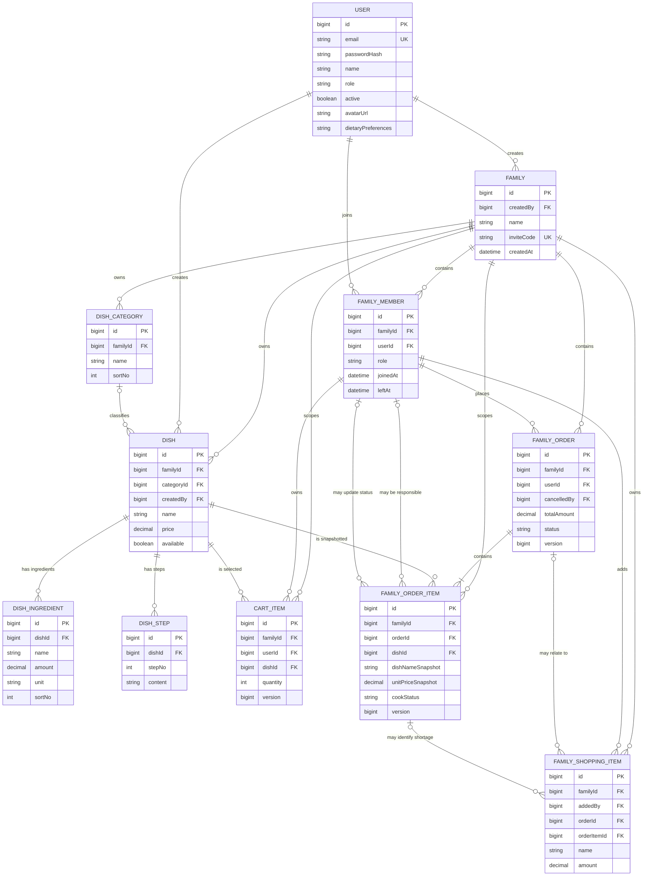

# MySQL 数据库设计方案

**文档状态：** 已完成 H2 到 MySQL 9.6.0 的首轮迁移。Flyway 10.10.0 已在 `homechef_platform` 成功应用 V1，Spring Boot 3.3.2 启动并通过 Hibernate `ddl-auto=validate`；核心注册、家庭、菜品、购物车、下单及历史快照 API 冒烟测试通过。Flyway 对 MySQL 9.6.0 的已验证范围警告、备份恢复、并发冲突、隔离与约束负向测试仍待补充。另：邀请码加入（M-03）新增 Flyway V4 给 `families` 加 `invite_code` 列与唯一约束，用户资料与饮食偏好（M-09）新增 Flyway V5 给 `users` 加 `avatar_url`、`dietary_preferences` 列；V4/V5 迁移与接口 HTTP 实测待执行。
**设计日期：** 2026-11-14
**目标：** 记录 MySQL 目标结构、迁移实施和当前验证状态。
**本轮迁移范围：** 正式库 `homechef_platform` 已由 Flyway V1 建立 11 张业务表；应用使用 Connector/J 9.7.0、Flyway Core/MySQL 10.10.0，Hibernate 使用 `validate`。Flyway 10.10.0 对 MySQL 9.6.0 的支持范围警告仍存在。迁移前 Flyway 13.12.2 与 Spring Boot 3.3.2 的兼容性失败记录保留在第 17 节，后续通过回到 Spring Boot BOM 管理的 Flyway 10.10.0 完成应用集成；H2 临时测试数据未导入。

> 第 4、12、17 节中标注“当前实体”或“本阶段”的内容保留了迁移前审查/兼容性测试记录；迁移后的实际执行和验证结果以第 18 节为准。第 6 节的建表 DDL 与已应用的 `V1__create_homechef_schema.sql` 对应。

## 1. 项目与数据库现状

当前持久层包含 11 个 JPA 实体，使用 Spring Data JPA/Hibernate。应用已连接 MySQL 9.6.0，Flyway 负责 schema 版本管理，Hibernate 只校验映射。H2 依赖已移除，H2 临时测试数据未迁移；实体的关联键主要仍以普通 `Long` 字段映射，由 Flyway DDL 的外键和复合外键保护数据一致性。

当前源码和配置入口：

- 实体：[entity 目录](../../src/main/java/com/fooddelivery/entity/)
- Repository：[repository 目录](../../src/main/java/com/fooddelivery/repository/)
- Service：[service 目录](../../src/main/java/com/fooddelivery/service/)
- 数据库配置：[application.properties](../../src/main/resources/application.properties)
- Maven 依赖：[pom.xml](../../pom.xml)
- 需求边界：[REQUIREMENT_CONTEXT.md](../requirements/REQUIREMENT_CONTEXT.md)
- 接口与源码交叉参考：[API_FRONTEND_CONTRACT.md](../backend/API_FRONTEND_CONTRACT.md)

当前代码没有 Invitation 实体；邀请码加入（M-03）已实现，采用固定 8 位邀请码通过 `families.invite_code` 列表达（Flyway V4）。个人资料与饮食偏好（M-09）已实现，通过 `users` 新增 `avatar_url`、`dietary_preferences` 列表达（Flyway V5），未新建独立偏好表；采购项已购状态由 `family_shopping_items.purchased` 列表达。

### 1.1 当前数据库配置清点

| 配置维度 | 当前源码事实 | 目标设计建议 |
|---|---|---|
| 默认数据库 | MySQL 9.6.0，库名 `homechef_platform` | 当前应用默认配置使用 MySQL；密码通过 `DB_PASSWORD` 环境变量提供 |
| 数据库连接 | MySQL `127.0.0.1:3306`，账号 `homechef_app`；应用配置可由 `DB_URL`、`DB_USERNAME`、`DB_PASSWORD` 覆盖 | JDBC 连通、Flyway 迁移及应用启动已实际验证；未修改 MySQL 服务配置 |
| JDBC 驱动 | MySQL Connector/J 9.7.0 runtime | 依赖树、构建、正式库 JDBC 连接和业务 API 均已验证 |
| ORM | Spring Data JPA / Hibernate | 保留；迁移期间使用 schema validation |
| Schema 管理 | Flyway 版本化迁移；Hibernate `validate` | V1 已成功应用，应用启动时 Hibernate 校验通过；V4 新增 `families.invite_code`、V5 新增 `users.avatar_url`/`dietary_preferences`（迁移待执行） |
| 连接池 | JPA starter 使用 Spring Boot 默认池；项目未显式配置池参数 | HikariCP；给出后续起步建议，按部署连接预算复核 |
| 初始数据 | 未发现项目级 SQL 种子数据脚本 | 用迁移脚本/独立初始化流程管理，不把示例数据混入结构迁移 |
| 迁移工具 | Flyway Core/MySQL 10.10.0 | 正式库 V1 迁移成功，仍有 MySQL 9.6.0 超出 Flyway 已验证版本范围的警告 |
| 环境 profile | 未发现独立 MySQL profile | 后续再决定环境变量、profile 和秘密管理方式 |

当前有少量单元测试；`mvn -B clean test` 已通过。该测试结果不替代仍待完成的数据库约束负向、并发和备份恢复测试。

## 2. 设计目标与原则

1. 目标数据库为本机现有 MySQL 9.6.0（数据库名 `homechef_platform`），在关系数据库中表达用户、家庭、成员及家庭业务数据的归属。该决定取代此前 MySQL 8.4 LTS 目标，原因是使用已安装并运行的实例，避免并行安装。
2. 以外键、复合外键和唯一约束减少孤儿记录、重复购物车项及跨家庭误关联。
3. 不把外键当成授权机制：Service 仍须验证登录用户当前属于目标家庭，并校验操作权限。
4. 保留订单历史；菜品下架不删除菜品行；订单金额由后端使用 `BigDecimal` 计算。
5. 已确认家庭成员退出保留关系记录并复用原记录；第一版家庭/菜品不物理删除，分类不提供删除，采购清单不增加已购状态。
6. 金额及用量统一两位小数；购物车、订单、订单明细采用 `@Version` 乐观锁设计。
7. DB-02 已确认 trim+小写邮箱规范化及 MySQL 默认 Unicode collation；DB-11 确认数据库允许 `COMPLETED`，业务流转仍由后续 Service 需求定义；DB-12 确认 `meal_period` 保持自由文本且不加 CHECK；DB-16 确认短暂停写并在切换前备份目标 MySQL 库、验证恢复。
8. 所有由当前实体或 Service 尚未保证的行为，在差异表中标出所需 Java 调整。
9. 表结构按 MySQL 9.6.0/InnoDB 设计；不生成针对 H2 的 SQL 兼容写法。

### 2.1 本次修订采纳的已确认决策

| 决策 | 当前设计结论 |
|---|---|
| DB-01 | 采用本机现有 MySQL 9.6.0；数据库名暂定 `homechef_platform`。该决定取代此前的 MySQL 8.4 LTS 目标，原因是避免并行安装 |
| DB-02 | 邮箱写入和登录前统一 trim + 小写；邮箱唯一比较不区分大小写；分类名/中文名称采用 MySQL 默认 Unicode collation `utf8mb4_0900_ai_ci` |
| DB-03 / DB-09 | 成员退出时保留 `family_members` 记录并设置 `left_at`；重新加入复用同一行 |
| DB-04 | 第一版禁止物理删除家庭，引用关系采用 `RESTRICT` |
| DB-05 / DB-06 | 菜品通过下架保留；分类第一版不提供删除 |
| DB-07 / DB-08 | 订单明细 `dish_id` 非空且历史引用限制删除；明细新增 `family_id`，由服务端从父订单赋值 |
| DB-10 | `CartItem`、`FamilyOrder`、`FamilyOrderItem` 设计 `@Version` 乐观锁 |
| DB-11 | 数据库允许订单状态 `COMPLETED`；不据此推断 Service 已实现完成流转 |
| DB-12 | `meal_period` 保持自由文本，不添加 CHECK 或字典表 |
| DB-13 | 菜品单价、订单金额、明细金额及食材/采购用量均采用两位小数 |
| DB-14 | 第一版采购清单仅查看和新增，不增加已购买状态 |
| DB-15 | 不迁移 H2 临时测试数据；MySQL 中重新准备测试数据 |
| DB-16 | 接受短暂停写；目标 MySQL 库迁移写入前备份并验证恢复 |

以上是数据设计决策；已落实的代码、配置和数据库实施情况见第 18 节。

## 3. MySQL 技术方案

| 项目 | 建议 | 理由与边界 |
|---|---|---|
| 版本 | MySQL 9.6.0，使用本机已安装实例 | 取代此前 MySQL 8.4 LTS 目标；正式库 V1 迁移、应用连接和 Hibernate validate 均已实测。Flyway 10.10.0 对 9.6.0 仍有超出其已验证范围的警告，需保留为兼容性风险。 |
| 存储引擎 | InnoDB | 支持事务、行级锁、外键、唯一索引和崩溃恢复；本项目订单创建与购物车清理要求原子性。 |
| 字符集 | `utf8mb4` | 支持中文及完整 Unicode；不要使用已过时的 `utf8` 三字节字符集。 |
| 默认排序规则 | `utf8mb4_0900_ai_ci` | 用户确认采用 MySQL 默认 Unicode 排序规则；分类名称比较及中文排序按该规则执行。邮箱在应用层 trim 后转小写，并使用同一大小写不敏感唯一比较。需通过目标 9.6.0 验证该 collation 存在和实际行为。 |
| 数据库名 | 暂定 `homechef_platform` | 已作为设计名采纳；实际创建前按部署环境核对命名。 |
| ID | 有符号 `BIGINT AUTO_INCREMENT` | 对应当前 Java `Long` 与 JPA `GenerationType.IDENTITY`，避免 unsigned BIGINT 超出 Java Long 正数范围。ID 一旦生成不更新。 |
| 时间 | `DATETIME(6)` 存 UTC；应用展示时转换当地时间 | `DATETIME` 不做会话时区转换，微秒精度与 Java 时间精度相容。当前实体使用 `LocalDateTime.now()`，必须在实施中统一使用 UTC 时钟（或改用 `Instant`）并配置 JDBC 会话时区；不得混用本地时间与 UTC。 |
| 状态枚举 | `VARCHAR(32)` + `CHECK` | 与当前 `@Enumerated(EnumType.STRING)` 相容；避免 MySQL 原生 ENUM 改动时需重建列。新增状态时需同步版本化修改 CHECK。 |
| 布尔值 | `BOOLEAN`（MySQL 实际以 `TINYINT(1)` 表示） | 与 Java `boolean` 映射直接；用 CHECK 限制 0/1。 |
| 字符串 | 按 DTO 约束设置 `VARCHAR(n)` | 明确长度、减少迁移后截断风险；JPA 注解、DTO 长度、数据库列长度需要一致。 |
| 连接池 | HikariCP（Spring Boot 默认） | 当前没有显式池参数。后续可以从 `minimumIdle=2`、`maximumPoolSize=10`、`connectionTimeout=30s` 作为单实例开发起点；它不是性能结论，需按实例数、MySQL `max_connections` 与并发负载重新核算。`maxLifetime` 应小于数据库/代理连接最大存活时间。 |

Spring Boot 3.3.2 BOM 管理 Hibernate 6.5.2.Final 和 Flyway 10.10.0；项目显式使用 Connector/J 9.7.0，满足优先使用 9.x 的决定。该驱动在 Java 17 下成功连接 MySQL 9.6.0。Flyway 最终回到 Spring Boot BOM 管理的 10.10.0，Spring Boot 和 Hibernate 版本未改动。

Flyway 的 MySQL 支持需另加 `org.flywaydb:flyway-mysql` 模块。当前采用的 10.10.0 成功在目标库执行完整 V1 migration；迁移日志仍提示 MySQL 9.6 新于该版本的已验证范围（该版本日志所述最新支持版本为 8.1）。这证明本项目当前 DDL 在本机组合下实际成功执行，不代表 Flyway 对 MySQL 9.6 获得官方验证；警告仍是兼容性风险。

Flyway 13.12.2 曾在隔离 schema 成功读取 10.10.0 创建的 history 并执行简单 V2 探针，但其 MySQL 9.6 范围警告和 Spring Boot 3.3.2 自动配置 API 不兼容均为迁移前测试记录。最终方案未采用 Flyway 13.12.2；历史测试详情保留在第 17 节和 [隔离兼容性测试报告](./MYSQL_MIGRATION_ISOLATED_TEST_REPORT.md)。

**Spring Boot 集成历史记录：** Flyway 13.12.2 与 Spring Boot 3.3.2 的集成曾因 `NoSuchMethodError` 失败；改回 BOM 管理的 Flyway 10.10.0 后，正式应用启动成功并通过 Hibernate `ddl-auto=validate`。前述失败未修改正式目标库；正式迁移成功结论以第 18 节为准。

**迁移前备选方案（已由实际执行取代，仅作为决策记录）：**

1. **保持 Spring Boot 3.3.2，使用其 BOM 管理的 Flyway 10.10.0**：本轮按此路线完成正式迁移；仍保留 MySQL 9.6 超出已验证范围警告。
2. **若坚持 Flyway 13.12.2**，需评估升级到正式支持其 API 的 Spring Boot 版本，并在用户批准后验证升级影响；本次不升级 Spring Boot/Hibernate。
3. 不建议通过自定义 Flyway Bean、排除自动配置或忽略错误来绕开 API 不兼容；这会偏离当前要求的真实集成验证。

`homechef_app@localhost` 当前仅有全局 `USAGE`，并额外拥有 `homechef_flyway_check.*` 范围权限；未授予其他 schema 或全局管理权限。隔离库现保留 `flyway_schema_history`、`flyway_compat_probe` 与 `flyway_13_compat_probe`，未自动清理。参考：[MySQL Connector/J 9.7.0 发布页](https://github.com/mysql/mysql-connector-j/releases/tag/9.7.0)、[Maven Central Connector/J 元数据](https://repo.maven.apache.org/maven2/com/mysql/mysql-connector-j/maven-metadata.xml)、[Flyway MySQL 支持说明](https://documentation.red-gate.com/fd/mysql-277579322.html)。

## 4. 现有 11 个实体审查

> 本节的“当前关系现状”记录迁移前的 Java Entity 基线；迁移后新增/调整的映射见第 18 节。

| 实体/表 | 当前用途与关键字段 | 当前关系现状 |
|---|---|---|
| `User` / `users` | 邮箱、密码哈希、姓名、系统角色、启用标记、头像 URL、饮食偏好（V5 新增） | 邮箱唯一；家庭角色不在 User 中；饮食偏好存逗号分隔白名单标签 |
| `Family` / `families` | 家庭名称、创建者 ID、创建时间、邀请码（`invite_code`，V4 新增，唯一） | `createdBy` 是普通 Long，没有 JPA 外键；`inviteCode` 是唯一字符串列 |
| `FamilyMember` / `family_members` | 家庭 ID、用户 ID、家庭角色、加入时间 | 已有 `(family_id,user_id)` 唯一约束；两个 ID 都是普通 Long |
| `Dish` / `dishes` | 家庭、名称、描述、图 URL、分类、耗时、单价、创建者、可用标记和时间 | family/category/creator 均为普通 Long |
| `DishCategory` / `dish_categories` | 家庭、分类名、排序号 | 已有 `(family_id,name)` 唯一约束；家庭 ID 是普通 Long |
| `DishIngredient` / `dish_ingredients` | 菜品、名称、用量、单位、排序号 | 菜品 ID 是普通 Long；未声明唯一排序约束 |
| `DishStep` / `dish_steps` | 菜品、步骤序号、内容、图片 | 菜品 ID 是普通 Long；未声明 `(dish_id,step_no)` 唯一约束 |
| `CartItem` / `cart_items` | 用户、家庭、菜品、数量、创建/更新时间 | 已有 `(user_id,family_id,dish_id)` 唯一约束；三个 ID 都是普通 Long |
| `FamilyOrder` / `family_orders` | 家庭、下单用户、金额、数量、订单状态、就餐时段、备注、开饭和取消信息 | family/user/cancelledBy 是普通 Long；含 `FamilyOrderItem` 集合 |
| `FamilyOrderItem` / `family_order_items` | 订单、菜品 ID、菜名/价格快照、数量、小计、备菜状态、负责人、阻塞原因、更新人/时间 | 仅 `order` 是 JPA `ManyToOne`；`dishId` 当前可空，其余用户 ID 是普通 Long |
| `FamilyShoppingItem` / `family_shopping_items` | 家庭、实际缺少食材、数量单位、可选订单/明细、添加人和时间 | 所有关联 ID 都是普通 Long；Service 会校验可选订单与明细同属当前家庭，但数据库未强制 |

### 4.1 全局系统角色与家庭角色

实际源码中：

- `User.Role` 为 `CUSTOMER`、`RESTAURANT_OWNER`、`ADMIN`。`AuthService.register` 固定写入 `CUSTOMER`，注册/登录响应会返回其名称；`CustomUserDetailsService` 会把存储角色映射为 Spring Security 的 `ROLE_<角色>`。
- 当前 `RESTAURANT_OWNER`、全局 `ADMIN` 只在 User 枚举中定义，未发现当前业务 Service 使用它们进行家庭权限判断。`SecurityConfig` 只要求登录，未发现按全局角色限制 API 的 `hasRole`/`hasAuthority` 规则；不过 User.Role 仍用于认证 authority 和注册/登录响应，因此不能直接删除该字段/枚举。
- 家庭权限由 `FamilyMember.FamilyRole` 的 `ADMIN`/`MEMBER` 决定；家庭创建者在同一 Service 事务流程中先建家庭，再写入 ADMIN 成员记录。

建议数据库继续分别保存 `users.role` 和 `family_members.role`，用不同列、不同 CHECK 约束，不合并为一个角色。现有旧值应在未来迁移时保留并统计；是否移除 `RESTAURANT_OWNER` 等枚举值属于 Java/权限演进决策，不是数据库迁移的前置删除动作。

## 5. ER 实体关系图

图中 `FAMILY_MEMBER.left_at`、`FAMILY_ORDER_ITEM.family_id` 和三个 `version` 字段已纳入当前 Java 实体及数据库；订单与订单明细已有 JPA 关系，其余图中关系主要由 Flyway DDL 外键建立。

<!-- mermaid-checked: every attribute is `<type> <name> [<key>] ["<description>"]` with at most one of PK/FK/UK, no \n in descriptions, no {} in descriptions, every relationship label is double-quoted -->


图的 `DISH_CATEGORY o|--o{ DISH` 表示菜品分类可为空；订单明细目标关系要求引用菜品且不允许删除被历史订单引用的菜品。`FAMILY_MEMBER` 是 User 与 Family 的多对多连接实体，同时携带家庭角色。

## 6. 数据库表结构设计

### 6.1 字段口径

- 所有 ID 使用 `BIGINT NOT NULL AUTO_INCREMENT`，外键列使用相同的有符号 `BIGINT`。
- 下列 DDL 每个字段明确声明类型、NULL/NOT NULL、默认值与索引/约束。`COMMENT` 标出需要新增或和当前实体有差异的字段。
- 时间采用 `DATETIME(6)`，由应用按 UTC 生成；`CURRENT_TIMESTAMP(6)` 仅作为直接 SQL 写入的兜底默认值。`updated_at` 由应用统一维护，不依赖 MySQL 隐式自动更新。
- 本设计不新增独立的邀请码表或饮食偏好表；邀请码与饮食偏好分别以 `families.invite_code`（V4）和 `users.avatar_url`/`users.dietary_preferences`（V5）列表达。

### 6.2 建议建库语句

以下是建库语句示例；本轮由 Workbench 创建了空目标库，因此**没有执行这条 `CREATE DATABASE` 示例**：

```sql
CREATE DATABASE IF NOT EXISTS homechef_platform
  CHARACTER SET utf8mb4
  COLLATE utf8mb4_0900_ai_ci;
```

该排序规则已按 DB-02 确认。应用还必须在写入和登录查询时执行一致的邮箱 trim+小写规范化；部署前应在 MySQL 9.6.0 实测 `utf8mb4_0900_ai_ci` 存在及唯一比较行为。

### 6.3 完整建表 DDL 草案

```sql
USE homechef_platform;

CREATE TABLE users (
    id BIGINT NOT NULL AUTO_INCREMENT,
    email VARCHAR(254) CHARACTER SET utf8mb4 COLLATE utf8mb4_0900_ai_ci NOT NULL,
    password_hash VARCHAR(255) NOT NULL COMMENT 'Password hash, never plaintext',
    name VARCHAR(50) NOT NULL,
    `role` VARCHAR(32) NOT NULL,
    active BOOLEAN NOT NULL DEFAULT TRUE,
    PRIMARY KEY (id),
    CONSTRAINT uk_users_email UNIQUE (email),
    CONSTRAINT chk_users_role CHECK (`role` IN ('CUSTOMER', 'RESTAURANT_OWNER', 'ADMIN')),
    CONSTRAINT chk_users_active CHECK (active IN (0, 1))
) ENGINE=InnoDB DEFAULT CHARSET=utf8mb4 COLLATE=utf8mb4_0900_ai_ci;

-- V5 增量：用户资料与饮食偏好（M-09）
-- ALTER TABLE users
--     ADD COLUMN avatar_url VARCHAR(500) NULL,
--     ADD COLUMN dietary_preferences VARCHAR(200) NULL;

CREATE TABLE families (
    id BIGINT NOT NULL AUTO_INCREMENT,
    name VARCHAR(50) NOT NULL,
    created_by BIGINT NOT NULL,
    created_at DATETIME(6) NOT NULL DEFAULT CURRENT_TIMESTAMP(6),
    PRIMARY KEY (id),
    KEY idx_families_created_by (created_by),
    CONSTRAINT fk_families_created_by
        FOREIGN KEY (created_by) REFERENCES users (id)
        ON DELETE RESTRICT ON UPDATE RESTRICT
) ENGINE=InnoDB DEFAULT CHARSET=utf8mb4 COLLATE=utf8mb4_0900_ai_ci;

CREATE TABLE family_members (
    id BIGINT NOT NULL AUTO_INCREMENT,
    family_id BIGINT NOT NULL,
    user_id BIGINT NOT NULL,
    `role` VARCHAR(20) NOT NULL,
    joined_at DATETIME(6) NOT NULL DEFAULT CURRENT_TIMESTAMP(6),
    left_at DATETIME(6) NULL COMMENT 'Confirmed logical leave marker; rejoin reuses this row',
    PRIMARY KEY (id),
    CONSTRAINT uk_family_members_family_user UNIQUE (family_id, user_id),
    KEY idx_family_members_user (user_id),
    CONSTRAINT chk_family_members_role CHECK (`role` IN ('ADMIN', 'MEMBER')),
    CONSTRAINT chk_family_members_leave_time
        CHECK (left_at IS NULL OR left_at >= joined_at),
    CONSTRAINT fk_family_members_family
        FOREIGN KEY (family_id) REFERENCES families (id)
        ON DELETE RESTRICT ON UPDATE RESTRICT,
    CONSTRAINT fk_family_members_user
        FOREIGN KEY (user_id) REFERENCES users (id)
        ON DELETE RESTRICT ON UPDATE RESTRICT
) ENGINE=InnoDB DEFAULT CHARSET=utf8mb4 COLLATE=utf8mb4_0900_ai_ci;

CREATE TABLE dish_categories (
    id BIGINT NOT NULL AUTO_INCREMENT,
    family_id BIGINT NOT NULL,
    name VARCHAR(50) NOT NULL,
    sort_no INT NOT NULL DEFAULT 0,
    PRIMARY KEY (id),
    CONSTRAINT uk_dish_categories_family_name UNIQUE (family_id, name),
    CONSTRAINT uk_dish_categories_family_id UNIQUE (family_id, id),
    KEY idx_dish_categories_family_sort (family_id, sort_no, id),
    CONSTRAINT chk_dish_categories_sort CHECK (sort_no >= 0),
    CONSTRAINT fk_dish_categories_family
        FOREIGN KEY (family_id) REFERENCES families (id)
        ON DELETE RESTRICT ON UPDATE RESTRICT
) ENGINE=InnoDB DEFAULT CHARSET=utf8mb4 COLLATE=utf8mb4_0900_ai_ci;

CREATE TABLE dishes (
    id BIGINT NOT NULL AUTO_INCREMENT,
    family_id BIGINT NOT NULL,
    name VARCHAR(100) NOT NULL,
    description VARCHAR(500) NULL,
    image_url VARCHAR(500) NULL,
    category_id BIGINT NULL,
    cooking_minutes INT NULL,
    price DECIMAL(10, 2) NOT NULL,
    created_by BIGINT NOT NULL,
    is_available BOOLEAN NOT NULL DEFAULT TRUE,
    created_at DATETIME(6) NOT NULL DEFAULT CURRENT_TIMESTAMP(6),
    updated_at DATETIME(6) NOT NULL DEFAULT CURRENT_TIMESTAMP(6),
    PRIMARY KEY (id),
    CONSTRAINT uk_dishes_family_id UNIQUE (family_id, id),
    KEY idx_dishes_family_created (family_id, created_at, id),
    KEY idx_dishes_family_category_created (family_id, category_id, created_at, id),
    KEY idx_dishes_family_available_created (family_id, is_available, created_at, id),
    CONSTRAINT chk_dishes_price CHECK (price >= 0),
    CONSTRAINT chk_dishes_cooking_minutes
        CHECK (cooking_minutes IS NULL OR cooking_minutes >= 0),
    CONSTRAINT chk_dishes_available CHECK (is_available IN (0, 1)),
    CONSTRAINT fk_dishes_family
        FOREIGN KEY (family_id) REFERENCES families (id)
        ON DELETE RESTRICT ON UPDATE RESTRICT,
    CONSTRAINT fk_dishes_category_same_family
        FOREIGN KEY (family_id, category_id)
        REFERENCES dish_categories (family_id, id)
        ON DELETE RESTRICT ON UPDATE RESTRICT,
    CONSTRAINT fk_dishes_creator_membership
        FOREIGN KEY (family_id, created_by)
        REFERENCES family_members (family_id, user_id)
        ON DELETE RESTRICT ON UPDATE RESTRICT
) ENGINE=InnoDB DEFAULT CHARSET=utf8mb4 COLLATE=utf8mb4_0900_ai_ci;

CREATE TABLE dish_ingredients (
    id BIGINT NOT NULL AUTO_INCREMENT,
    dish_id BIGINT NOT NULL,
    name VARCHAR(100) NOT NULL,
    amount DECIMAL(10, 2) NOT NULL,
    unit VARCHAR(20) NOT NULL,
    sort_no INT NOT NULL DEFAULT 0,
    PRIMARY KEY (id),
    CONSTRAINT uk_dish_ingredients_dish_sort UNIQUE (dish_id, sort_no),
    CONSTRAINT chk_dish_ingredients_amount CHECK (amount >= 0),
    CONSTRAINT chk_dish_ingredients_sort CHECK (sort_no >= 0),
    CONSTRAINT fk_dish_ingredients_dish
        FOREIGN KEY (dish_id) REFERENCES dishes (id)
        ON DELETE RESTRICT ON UPDATE RESTRICT
) ENGINE=InnoDB DEFAULT CHARSET=utf8mb4 COLLATE=utf8mb4_0900_ai_ci;

CREATE TABLE dish_steps (
    id BIGINT NOT NULL AUTO_INCREMENT,
    dish_id BIGINT NOT NULL,
    step_no INT NOT NULL,
    content VARCHAR(500) NOT NULL,
    image_url VARCHAR(500) NULL,
    PRIMARY KEY (id),
    CONSTRAINT uk_dish_steps_dish_step UNIQUE (dish_id, step_no),
    CONSTRAINT chk_dish_steps_step_no CHECK (step_no >= 1),
    CONSTRAINT fk_dish_steps_dish
        FOREIGN KEY (dish_id) REFERENCES dishes (id)
        ON DELETE RESTRICT ON UPDATE RESTRICT
) ENGINE=InnoDB DEFAULT CHARSET=utf8mb4 COLLATE=utf8mb4_0900_ai_ci;

CREATE TABLE cart_items (
    id BIGINT NOT NULL AUTO_INCREMENT,
    user_id BIGINT NOT NULL,
    family_id BIGINT NOT NULL,
    dish_id BIGINT NOT NULL,
    quantity INT NOT NULL,
    created_at DATETIME(6) NOT NULL DEFAULT CURRENT_TIMESTAMP(6),
    updated_at DATETIME(6) NOT NULL DEFAULT CURRENT_TIMESTAMP(6),
    version BIGINT NOT NULL DEFAULT 0 COMMENT 'Confirmed @Version optimistic lock field',
    PRIMARY KEY (id),
    CONSTRAINT uk_cart_user_family_dish UNIQUE (user_id, family_id, dish_id),
    KEY idx_cart_user_family_created (user_id, family_id, created_at, id),
    CONSTRAINT chk_cart_quantity CHECK (quantity BETWEEN 1 AND 99),
    CONSTRAINT chk_cart_version CHECK (version >= 0),
    CONSTRAINT fk_cart_family
        FOREIGN KEY (family_id) REFERENCES families (id)
        ON DELETE RESTRICT ON UPDATE RESTRICT,
    CONSTRAINT fk_cart_member
        FOREIGN KEY (family_id, user_id)
        REFERENCES family_members (family_id, user_id)
        ON DELETE RESTRICT ON UPDATE RESTRICT,
    CONSTRAINT fk_cart_dish_same_family
        FOREIGN KEY (family_id, dish_id)
        REFERENCES dishes (family_id, id)
        ON DELETE RESTRICT ON UPDATE RESTRICT
) ENGINE=InnoDB DEFAULT CHARSET=utf8mb4 COLLATE=utf8mb4_0900_ai_ci;

CREATE TABLE family_orders (
    id BIGINT NOT NULL AUTO_INCREMENT,
    family_id BIGINT NOT NULL,
    user_id BIGINT NOT NULL,
    total_amount DECIMAL(12, 2) NOT NULL,
    item_count INT NOT NULL,
    status VARCHAR(20) NOT NULL,
    meal_period VARCHAR(20) NULL,
    remark VARCHAR(500) NULL,
    meal_served BOOLEAN NOT NULL DEFAULT FALSE,
    meal_served_at DATETIME(6) NULL,
    cancelled_at DATETIME(6) NULL,
    cancelled_by BIGINT NULL,
    created_at DATETIME(6) NOT NULL DEFAULT CURRENT_TIMESTAMP(6),
    updated_at DATETIME(6) NOT NULL DEFAULT CURRENT_TIMESTAMP(6),
    version BIGINT NOT NULL DEFAULT 0 COMMENT 'Confirmed @Version optimistic lock field',
    PRIMARY KEY (id),
    CONSTRAINT uk_family_orders_family_id UNIQUE (family_id, id),
    KEY idx_family_orders_family_created (family_id, created_at, id),
    KEY idx_family_orders_family_user_created (family_id, user_id, created_at, id),
    CONSTRAINT chk_family_orders_status
        CHECK (status IN ('CREATED', 'PREPARING', 'COMPLETED', 'CANCELLED')),
    CONSTRAINT chk_family_orders_amount_count
        CHECK (total_amount >= 0 AND item_count > 0),
    CONSTRAINT chk_family_orders_meal_served
        CHECK ((meal_served = FALSE AND meal_served_at IS NULL)
            OR (meal_served = TRUE AND meal_served_at IS NOT NULL)),
    CONSTRAINT chk_family_orders_cancellation
        CHECK ((status = 'CANCELLED' AND cancelled_at IS NOT NULL AND cancelled_by IS NOT NULL)
            OR (status <> 'CANCELLED' AND cancelled_at IS NULL AND cancelled_by IS NULL)),
    CONSTRAINT chk_family_orders_version CHECK (version >= 0),
    CONSTRAINT fk_family_orders_family
        FOREIGN KEY (family_id) REFERENCES families (id)
        ON DELETE RESTRICT ON UPDATE RESTRICT,
    CONSTRAINT fk_family_orders_member
        FOREIGN KEY (family_id, user_id)
        REFERENCES family_members (family_id, user_id)
        ON DELETE RESTRICT ON UPDATE RESTRICT,
    CONSTRAINT fk_family_orders_canceller_member
        FOREIGN KEY (family_id, cancelled_by)
        REFERENCES family_members (family_id, user_id)
        ON DELETE RESTRICT ON UPDATE RESTRICT
) ENGINE=InnoDB DEFAULT CHARSET=utf8mb4 COLLATE=utf8mb4_0900_ai_ci;

CREATE TABLE family_order_items (
    id BIGINT NOT NULL AUTO_INCREMENT,
    family_id BIGINT NOT NULL COMMENT 'Confirmed; copied from the parent order by the service',
    order_id BIGINT NOT NULL,
    dish_id BIGINT NOT NULL,
    dish_name_snapshot VARCHAR(100) NOT NULL,
    unit_price_snapshot DECIMAL(10, 2) NOT NULL,
    quantity INT NOT NULL,
    subtotal DECIMAL(12, 2) NOT NULL,
    cook_status VARCHAR(20) NOT NULL DEFAULT 'PENDING',
    responsible_user_id BIGINT NULL,
    blocked_reason VARCHAR(200) NULL,
    cook_status_updated_by BIGINT NULL,
    cook_status_updated_at DATETIME(6) NULL,
    created_at DATETIME(6) NOT NULL DEFAULT CURRENT_TIMESTAMP(6),
    version BIGINT NOT NULL DEFAULT 0 COMMENT 'Confirmed @Version optimistic lock field',
    PRIMARY KEY (id),
    CONSTRAINT uk_family_order_items_family_order_id
        UNIQUE (family_id, order_id, id),
    KEY idx_family_order_items_order (order_id, id),
    CONSTRAINT chk_family_order_items_cook_status
        CHECK (cook_status IN ('PENDING', 'COOKING', 'READY', 'BLOCKED', 'SERVED')),
    CONSTRAINT chk_family_order_items_values
        CHECK (unit_price_snapshot >= 0
            AND quantity BETWEEN 1 AND 99
            AND subtotal = unit_price_snapshot * quantity),
    CONSTRAINT chk_family_order_items_blocked_reason
        CHECK ((cook_status = 'BLOCKED'
                AND blocked_reason IS NOT NULL
                AND CHAR_LENGTH(TRIM(blocked_reason)) > 0)
            OR (cook_status <> 'BLOCKED' AND blocked_reason IS NULL)),
    CONSTRAINT chk_family_order_items_status_audit
        CHECK ((cook_status_updated_by IS NULL AND cook_status_updated_at IS NULL)
            OR (cook_status_updated_by IS NOT NULL AND cook_status_updated_at IS NOT NULL)),
    CONSTRAINT chk_family_order_items_version CHECK (version >= 0),
    CONSTRAINT fk_family_order_items_family
        FOREIGN KEY (family_id) REFERENCES families (id)
        ON DELETE RESTRICT ON UPDATE RESTRICT,
    CONSTRAINT fk_family_order_items_order_same_family
        FOREIGN KEY (family_id, order_id)
        REFERENCES family_orders (family_id, id)
        ON DELETE RESTRICT ON UPDATE RESTRICT,
    CONSTRAINT fk_family_order_items_dish_same_family
        FOREIGN KEY (family_id, dish_id)
        REFERENCES dishes (family_id, id)
        ON DELETE RESTRICT ON UPDATE RESTRICT,
    CONSTRAINT fk_family_order_items_responsible_member
        FOREIGN KEY (family_id, responsible_user_id)
        REFERENCES family_members (family_id, user_id)
        ON DELETE RESTRICT ON UPDATE RESTRICT,
    CONSTRAINT fk_family_order_items_status_member
        FOREIGN KEY (family_id, cook_status_updated_by)
        REFERENCES family_members (family_id, user_id)
        ON DELETE RESTRICT ON UPDATE RESTRICT
) ENGINE=InnoDB DEFAULT CHARSET=utf8mb4 COLLATE=utf8mb4_0900_ai_ci;

CREATE TABLE family_shopping_items (
    id BIGINT NOT NULL AUTO_INCREMENT,
    family_id BIGINT NOT NULL,
    name VARCHAR(100) NOT NULL,
    amount DECIMAL(10, 2) NOT NULL,
    unit VARCHAR(20) NOT NULL,
    order_id BIGINT NULL,
    order_item_id BIGINT NULL,
    added_by BIGINT NOT NULL,
    created_at DATETIME(6) NOT NULL DEFAULT CURRENT_TIMESTAMP(6),
    PRIMARY KEY (id),
    KEY idx_shopping_family_created (family_id, created_at, id),
    KEY idx_shopping_family_order_item (family_id, order_id, order_item_id),
    CONSTRAINT chk_shopping_amount CHECK (amount > 0),
    CONSTRAINT chk_shopping_order_item_requires_order
        CHECK (order_item_id IS NULL OR order_id IS NOT NULL),
    CONSTRAINT fk_shopping_family
        FOREIGN KEY (family_id) REFERENCES families (id)
        ON DELETE RESTRICT ON UPDATE RESTRICT,
    CONSTRAINT fk_shopping_adder_member
        FOREIGN KEY (family_id, added_by)
        REFERENCES family_members (family_id, user_id)
        ON DELETE RESTRICT ON UPDATE RESTRICT,
    CONSTRAINT fk_shopping_order_same_family
        FOREIGN KEY (family_id, order_id)
        REFERENCES family_orders (family_id, id)
        ON DELETE RESTRICT ON UPDATE RESTRICT,
    CONSTRAINT fk_shopping_order_item_matches_order
        FOREIGN KEY (family_id, order_id, order_item_id)
        REFERENCES family_order_items (family_id, order_id, id)
        ON DELETE RESTRICT ON UPDATE RESTRICT
) ENGINE=InnoDB DEFAULT CHARSET=utf8mb4 COLLATE=utf8mb4_0900_ai_ci;
```

**关于复合外键和冗余列：** `family_id` 在 `family_order_items` 中是已确认新增字段。它允许数据库同时约束订单明细的家庭、父订单、菜品及成员关联，避免仅凭两个互不相关的 ID 拼出跨家庭关系。它是有意的冗余键，必须由 Service 从父订单填充，不能接受客户端传值。

MySQL 对复合外键中含 NULL 的可选关联不执行完整键匹配；因此采购项可以不关联订单，但 `order_item_id` 不为空时 CHECK 要求 `order_id` 同时存在，复合外键再验证明细确实属于该订单和家庭。

## 7. 主键、外键、唯一约束与 CHECK

### 7.1 主键和外键

- 所有表使用自增 `BIGINT` 代理主键，对应现有 IDENTITY。
- 外键均 `ON UPDATE RESTRICT`：业务 ID 不可变。
- 家庭成员 `(family_id,user_id)`、分类 `(family_id,id)`、菜品 `(family_id,id)`、订单 `(family_id,id)`、订单明细 `(family_id,order_id,id)` 的复合唯一键用于形成同家庭外键。
- 这些复合唯一键中的某些组合虽然因 `id` 全局唯一而逻辑上重复，但 MySQL 需要被引用列有对应的唯一索引；不应仅因“看起来冗余”删除。
- 家庭成员保留为逻辑离开记录（`left_at`），可让历史订单、菜品创建者和备菜责任仍能引用成员身份。退出时设置离开时间；重新加入时复用同一 `(family_id,user_id)` 行并清空 `left_at`。`joined_at` 保留首次加入时间，不另存重复进出区间。Service 必须将 `left_at IS NOT NULL` 的成员拒绝为当前成员。

### 7.2 唯一与非空规则

| 规则 | 当前实体 | 目标设计 |
|---|---|---|
| 用户邮箱唯一 | 已有 `unique=true` | `UNIQUE(email)`；应用写入/登录时 trim 并转小写，列使用 `utf8mb4_0900_ai_ci` |
| 家庭-用户关系唯一 | 已有 `(family_id,user_id)` | 保留；支持多家庭成员关系和家庭归属复合外键 |
| 家庭内分类名唯一 | 已有 `(family_id,name)` | 保留；大小写/重音折叠行为由排序规则决定 |
| 购物车同用户/家庭/菜品合并 | 已有 `(user_id,family_id,dish_id)` | 原样保留唯一约束并作为并发兜底；服务需处理唯一冲突并重试/重新读取 |
| 菜品步骤序号 | 当前无唯一约束 | 新增 `UNIQUE(dish_id,step_no)` 和 `step_no >= 1`；连续无空洞仍由 Service 校验 |
| 食材排序号 | 当前无唯一约束；Service 按列表索引赋值 | 建议 `UNIQUE(dish_id,sort_no)`，并要求 `sort_no >= 0` |
| 订单与订单明细 | 已有 JPA `order_id` 关系 | 增加家庭一致性复合 FK；历史明细不允许被物理删除 |
| 采购清单添加人 | 当前普通 `addedBy` Long | 增加用户/家庭成员复合 FK；退出成员记录保留以保护来源可追溯性 |

### 7.3 CHECK 可做与不可做的边界

适合数据库 CHECK：角色/状态值、布尔取值、非负金额/耗时/排序号、正数量、阻塞状态必须有原因、取消/开饭标志与时间一致、明细小计等于单价乘数量。MySQL 9.6 目标环境中的 CHECK 行为仍须纳入迁移验收。

仍由 Service/事务保证：家庭权限和当前成员资格、创建家庭时 `created_by` 用户同时成为该家庭 ADMIN、备菜状态合法迁移、订单总额等于所有明细小计之和、`item_count` 等于明细行数、步骤序号连续、订单取消规则、购物车提交后只清理已提交内容。CHECK 不能跨行查询求和，也不能表达合法状态转换；普通外键也不能单独保证家庭创建者对应的成员角色为 ADMIN。

## 8. 索引设计依据

索引来自实际 Repository/Service 查询；未给所有字段盲目加索引。

| 表 | 索引 | 对应查询/理由 |
|---|---|---|
| `users` | 唯一 `email` | `findByEmail`、`existsByEmail` 登录/注册查询；无须另建重复普通索引 |
| `families` | `created_by` | 外键索引；当前没有通过创建者列过滤的 Repository 查询 |
| `family_members` | 唯一 `(family_id,user_id)`；普通 `(user_id)` | 前者支持家庭成员列表、成员存在校验及复合 FK；后者支持 `findByUserId` |
| `dish_categories` | 唯一 `(family_id,name)`；唯一 `(family_id,id)`；普通 `(family_id,sort_no,id)` | 家庭内名称查重、同家庭引用、按家庭排序列出分类 |
| `dishes` | 唯一 `(family_id,id)`；普通 `(family_id,created_at,id)`、`(family_id,category_id,created_at,id)`、`(family_id,is_available,created_at,id)` | 覆盖家庭菜品列表、按分类/可用状态筛选并按创建时间倒序 |
| `dishes` 搜索 | 不新增普通关键词索引 | 当前 `ContainingIgnoreCase` 是前后带 `%` 的模糊查询，普通 B-tree 通常不能有效加速；FULLTEXT 语义不同，需另行评估 |
| `dish_ingredients` | 唯一 `(dish_id,sort_no)` | 按菜品读取有序食材、删除/重建食材、约束排序唯一 |
| `dish_steps` | 唯一 `(dish_id,step_no)` | 按菜品读取步骤、删除/重建步骤、约束步骤号唯一 |
| `cart_items` | 唯一 `(user_id,family_id,dish_id)`；普通 `(user_id,family_id,created_at,id)` | 合并菜品、按个人和家庭读购物车及创建时间排序；复合唯一索引不能提供该排序列 |
| `family_orders` | 唯一 `(family_id,id)`；普通 `(family_id,created_at,id)`、`(family_id,user_id,created_at,id)` | 复合外键、家庭订单倒序列表、家庭内某成员的订单列表 |
| `family_order_items` | 唯一 `(family_id,order_id,id)`；普通 `(order_id,id)` | 采购清单复合引用、按订单读取明细、订单明细到家庭查询 |
| `family_shopping_items` | 普通 `(family_id,created_at,id)`、`(family_id,order_id,order_item_id)` | 家庭采购清单倒序查询和两个可选订单/明细复合外键维护；两列索引是三列索引的左前缀，单独建立会冗余 |

InnoDB 会为缺少索引的外键列创建支持索引，但 DDL 显式声明关键查询索引，避免隐式索引名称和用途不清。未来接口增加分页、家庭历史归档查询后，应基于慢查询/执行计划重新评估。

## 9. 删除与级联策略

| 对象 | 数据库策略 | 业务/Service 策略 |
|---|---|---|
| 用户 | 被家庭、订单等引用时 `RESTRICT`；不级联清除历史数据 | 当前使用 `active=false` 停用账号；外键保护被引用的用户记录 |
| 家庭 | 所有关联数据 `RESTRICT`，不物理级联 | 第一版禁止物理删除家庭；如未来需要“删除”，须另行确认归档/匿名化规则 |
| 家庭成员 | 成员记录保留；退出设置 `left_at`，重入复用原行并清空 `left_at` | 退出时 Service 同事务清空购物车并阻止后续写入；历史订单、菜品创建者、添加人信息保留。当前唯一约束 `(family_id,user_id)` 支持复用 |
| 菜品 | 菜品子表、购物车及订单明细外键统一 `RESTRICT`；不依赖级联删除清理 | 第一版通过 `is_available=false` 下架，不提供物理删除能力；订单历史快照及菜品关系保留 |
| 分类 | 菜品分类引用 `RESTRICT` | 第一版不提供分类删除；如未来允许，需先明确置空/重分类规则 |
| 订单 | `RESTRICT` | 当前没有订单删除接口；取消用 `status=CANCELLED` 并记录取消时间/人，保留历史 |
| 订单明细 | 订单与菜品均 `RESTRICT`；不设置数据库 `ON DELETE CASCADE` | 当前 JPA 使用 `CascadeType.ALL` 和 `orphanRemoval=true`，这可能物理删除订单明细；实施时应去掉 remove/orphan 删除语义，保留创建/更新级联或显式保存 |
| 采购清单 | 家庭、添加人、订单和订单明细引用 `RESTRICT` | 第一版仅查看和新增；不增加已购买状态，也不提供删除或编辑接口 |

数据库 `ON DELETE` 与 JPA `CascadeType` 是两套机制。必须同时检查 JPA orphan removal、Service 删除方法和数据库外键；不能因为当前订单实体有 `CascadeType.ALL` 就把订单历史配置为数据库级联删除。

`RESTRICT` 只会阻止仍被引用的行被删除，不能单独禁止删除完全未被引用的家庭、菜品或分类。第一版“不物理删除”的要求还需由应用不暴露对应删除操作来落实；若以后要求数据库账号层面也无法删除，需另行设计权限或触发器，不在本次 DDL 中添加。

## 10. 金额、数量和时间处理

| 业务值 | Java 当前类型/精度 | MySQL 目标 | 说明 |
|---|---|---|---|
| 菜品单价 | `BigDecimal`，实体 `precision=10, scale=2`；DTO 最多 8 位整数、2 位小数 | `DECIMAL(10,2)` | 与当前精度一致，允许零价；CHECK 非负 |
| 订单总额 | `BigDecimal`，实体 `precision=12, scale=2` | `DECIMAL(12,2)` | 由 Service 求明细小计之和；数据库 CHECK 无法校验跨行合计 |
| 明细单价快照 | `BigDecimal`，实体 `precision=10, scale=2` | `DECIMAL(10,2)` | 创建订单时复制当前菜品价 |
| 明细小计 | `BigDecimal`，实体 `precision=12, scale=2` | `DECIMAL(12,2)` | 当前为单价乘整数数量；保留精确十进制，不用 DOUBLE |
| 菜品食材用量 | `BigDecimal`，实体 `precision=10, scale=2`；DTO 最多 2 位小数 | `DECIMAL(10,2)` | 当前业务允许 0；若需毫克/小数更细用量需先扩展需求和 DTO |
| 采购用量 | `BigDecimal`，实体 `precision=10, scale=2` | `DECIMAL(10,2)` | 已确认统一两位小数；DTO 要求大于 0，但缺少 `@Digits`，实施时须补参数精度校验，避免数据库截断/溢出 |
| 数量 | Java `Integer` | `INT` | 购物车 Service 限制 1–99；DB CHECK 同步防止绕过服务的非法值 |
| 耗时/排序/步骤号 | Java `Integer`/`int` | `INT` | 使用 CHECK 限制耗时/排序非负、步骤号从 1 起；序号连续仍由 Service 保证 |
| 创建/更新时间 | Java `LocalDateTime` | `DATETIME(6)` | 值按 UTC 写入；Service 当前使用本地系统 `LocalDateTime.now()`，实施前要统一 UTC 时钟。不要使用会自动按 session 时区转换的 `TIMESTAMP` 来混存本地时间 |

已确认金额和用量统一保留两位小数。当前 `BigDecimal.multiply` 和 `add` 对 scale=2 的单价乘整数数量为精确十进制运算，不需要二进制浮点或舍入；实施时应通过 `@Digits`/显式校验保证整数位和小数位符合 DECIMAL 列，计算结果用 `setScale(2, RoundingMode.UNNECESSARY)` 或等价精度断言拒绝意外舍入。`DECIMAL(12,2)` 最多 10 位整数，汇总总额也必须在写入前检查上限。禁止在 Controller/Service 转成 `double`。未来出现折扣、比例税或除法时，必须单独定义舍入模式与舍入时点。MySQL DECIMAL 是精确十进制类型；请求验证、Java 精度和 DB 列精度必须一致。

## 11. 事务与并发设计

| 场景 | 数据库/事务措施 | Service/Java 责任 |
|---|---|---|
| 多人同时添加同一购物车菜品 | 唯一 `(user_id,family_id,dish_id)` 防止重复行 | 当前代码为“先查再保存并累加”，并发时可能丢增量或遇唯一冲突；用原子 upsert/行锁或乐观锁重试，唯一冲突后重新读取并合并 |
| 同一购物车数量并发修改 | 已确认 `CartItem.version` 映射 `@Version` | 捕获乐观锁冲突并返回可重试冲突；只靠 CHECK/唯一约束不能避免覆盖 |
| 多人同时提交相同购物车 | 当前 `FamilyOrderServiceImpl.createOrder` 已处于事务，订单和清车同事务；InnoDB 保证原子提交 | 提交前锁定该用户该家庭的购物车行（Repository 加写锁），锁范围内重查菜品和价格、生成订单明细、清空购物车；空车/锁竞争返回明确结果。若以后需要网络重试幂等，应另确认幂等键需求 |
| 下单时菜品价格/可用状态变化 | 菜品查询与订单/明细写入在同一事务；可对菜品读取加锁，或使用版本号并检测变化 | 后端重新取价和核算。当前 Service 已重新查询价格，但未显式锁定菜品；需要决定允许并发改价时以哪一刻的价格为准 |
| 订单菜品多人同时改备菜状态 | 已确认 `FamilyOrderItem.version` 乐观锁；数据库 CHECK 限制可用状态值和 BLOCKED 原因完整性 | 状态迁移合法性依赖 `CookStatus.canTransitionTo`，必须由 Service 在事务内检查；并发冲突回滚并提示刷新，不可用 CHECK 表达状态机 |
| 订单整体状态同时变化 | 已确认 `family_orders.version` 乐观锁 | 当前取消/开始备菜/开饭是读-改-写；增加 `@Version` 并对非法转换返回冲突 |
| 多人同时添加采购清单 | InnoDB 单条 INSERT 原子，家庭/成员/订单外键验证关联 | 当前按请求逐条新增，不定义“同名项合并”；不加 `(family_id,name)` 唯一约束，避免错误合并不同单位/来源 |
| 创建订单与清空购物车 | 单个 `@Transactional` 中写订单/明细并删除用户+家庭购物车 | 当前已有事务边界；需在 MySQL 中验证运行于 InnoDB，且并发提交锁定购物车，避免两个事务都读到相同条目 |

### 11.1 乐观锁字段与 JPA 映射

已确认 `cart_items`、`family_orders`、`family_order_items` 均包含 `version BIGINT NOT NULL DEFAULT 0`，对应实体分别增加 JPA `@Version` 字段，例如：

```java
@Version
@Column(nullable = false)
private Long version;
```

Hibernate 在更新时校验并递增版本；业务代码不得自行递增或从请求 DTO 接受该值。新实体由持久层初始化版本，直接 SQL 初始化数据使用 `0`。更新冲突应回滚事务并显式转换为可识别的并发冲突响应。版本列本身不替代 Service 的家庭成员权限、订单状态流转和购物车业务校验；并发冲突的 API 状态码与提示仍需后续实现和测试。唯一约束是防重底线，不是完整并发控制。

## 12. 现有实体与目标结构差异

> 本表用于说明迁移前差异及其处理方式，不应将“当前情况”列理解为迁移后的状态。已实施项见第 18 节。

“必须”指为了落实本方案的数据完整性/行为必须调整；“建议”是更清晰或更高效，但可经确认选择其他方案。本节只提出，不修改代码。

| 实体 | 当前情况 | 目标结构差异 | Java 调整 | 原因/级别 |
|---|---|---|---|---|
| `User` | 邮箱唯一；name/email 未显式长度；角色为字符串枚举；密码字段叫 `password` | `email` 254、`name` 50、`password_hash` 255、角色 CHECK | `@Column(length=...)`、`@Column(name="password_hash")`；注册和登录时邮箱 trim+小写（DB-02） | 列名/长度映射及统一邮箱规范化为**必须**；数据库 CHECK 无需合并系统与家庭角色 |
| `Family` | `createdBy` 是普通 Long；有创建时间 | `created_by` FK 到用户 | 可继续保留 scalar ID；若要 ORM 导航再增加关系映射 | 外键约束为数据库迁移**必须**；JPA `@ManyToOne` 是**可选** |
| `FamilyMember` | family/user 普通 Long；已有组合唯一和枚举角色；没有离开时间 | 家庭/用户外键；新增已确认的 `left_at` | 增加字段；退出保留该行并设置 `left_at`，重新加入复用该行并清空；当前成员查询过滤 `left_at IS NULL` | FK、字段及退出/重入语义均为已确认的**必须调整** |
| `DishCategory` | familyId 普通 Long；家庭名唯一、sortNo | family FK、同家庭复合候选键和排序索引 | 关系映射可选；保持当前唯一约束语义 | 数据库 FK/索引为**必须**，不需要新增业务字段 |
| `Dish` | family/category/createdBy 都是 Long；价格已有 `DECIMAL(10,2)` | 家庭 FK、同家庭分类 FK、创建者成员 FK；唯一 `(family_id,id)` | scalar ID 可保留；需邮箱/时间统一策略以外无新字段 | 复合 FK 与 DDL 为**必须**；ORM 关系映射可选 |
| `DishIngredient` | dishId 普通 Long；金额精度10,2；没有排序唯一 | dish FK、`(dish_id,sort_no)` 唯一、CHECK | 通常无需业务字段；可加 JPA 约束注解以与 migration 对齐 | DB 层约束为**必须**；当前服务已顺序赋值 |
| `DishStep` | dishId 普通 Long；Service 校验 1..N 连续 | dish FK、`(dish_id,step_no)` 唯一和正数 CHECK | 约束注解可选；Service 仍要验证连续性 | 唯一/外键为**必须**，连续性是跨行规则 |
| `CartItem` | 三个 ID 均为 Long；已有指定组合唯一；无版本号 | 家庭成员/同家庭菜品复合 FK；已确认 `version` | 增加 `@Version`，并在并发增加时实现原子更新或冲突重试 | FK 和乐观锁均为已确认的**必须调整** |
| `FamilyOrder` | family/user/cancelledBy 普通 Long；有订单状态、取消和开饭字段；无版本号 | 家庭/成员复合 FK；时间-状态 CHECK；已确认 `version` | 增加 `@Version`；确保取消路径记录同一家庭成员 | FK/CHECK 和乐观锁为设计要求；订单取消权限差异见 12.3 |
| `FamilyOrderItem` | 只有 order 有 JPA 关系；dishId 可空；已有名称/单价/数量/小计快照；用户 ID 是普通 Long；父集合 `CascadeType.ALL` + `orphanRemoval=true` | 新增已确认的 `family_id`、`version`；dishId 改非空并同家庭外键；成员外键；删除行为限制 | **必须**补 `familyId` 并在下单创建明细时从父订单赋值；增加 `@Version`；禁止 orphanRemoval 删除历史明细 | 家庭一致性、历史保护和乐观锁均为已确认的**必须调整** |
| `FamilyShoppingItem` | family/order/orderItem/addedBy 都是 Long；amount 10,2；没有 purchased 字段 | 家庭 FK、添加人成员 FK、订单/明细复合 FK、正数 CHECK | 为精度补 `@Digits`；可增加关联映射但不是必须；第一版不加 purchased 字段 | 关系完整性为 DB **必须**；采购精度验证为**必须**；不增加已购买状态为已确认决策 |

### 12.1 现有模型问题摘要

1. 除订单—订单明细外，当前 Entity 没有 JPA FK 关系；H2 表可能接受孤儿 ID。目标迁移必须检查历史行并在加约束前修复。
2. 当前存在家庭/用户/菜品 ID，但没有数据库强制“同家庭”约束。购物车、菜品分类、订单和采购关联应采用上述复合外键；前提是服务填充一致的 family ID。
3. `FamilyOrderItem.dishId` 当前可空，与已确认的订单历史引用规则不一致；目标设为 NOT NULL + RESTRICT。迁移前必须检查是否已有 null/孤儿数据。
4. 食材和步骤没有数据库排序唯一约束；购物车组合唯一、成员组合唯一、家庭分类名唯一已存在，可沿用。
5. 所有实体使用 `Long` ID，但数据库外键目标必须同为有符号 BIGINT；不能主表 signed、子表 unsigned 混用。
6. `FamilyOrderItem` 有 `CascadeType.ALL`/`orphanRemoval=true`，与不可丢失历史订单明细冲突；应调整 ORM 删除语义。
7. 当前无 `@Version`，多用户并发修改购物车或订单状态存在丢更新风险。
8. `FamilyShoppingItem.amount` DTO 未声明 `@Digits`，与 `DECIMAL(10,2)` 有精度/溢出风险；需参数层与 Entity 统一。
9. `FamilyServiceImpl.listMyFamilies` 通过加载所有 `FamilyMember` 再内存过滤来统计成员数；索引无法解决全表加载，应后续提供按家庭批量计数的 Repository 查询。
10. 菜品关键字搜索使用忽略大小写的包含匹配；普通 B-tree 不足以优化 `%keyword%`，不应无依据地宣称加索引即可解决。
11. OrderStatus 有 `COMPLETED`，但当前检查到的 Service 未发现将订单设置为 `COMPLETED` 的流程；需补需求/状态流转，不应仅靠数据库 CHECK 认定已实现。
12. 系统用户角色在认证 authority 和响应中仍被使用；旧外卖角色虽未用于家庭权限判定，迁移期间必须保留已有值。

### 12.2 订单明细快照范围

| 字段 | 当前状态 | 目标处理 |
|---|---|---|
| `dish_name_snapshot` | 已存在，非空，长度 100 | 保留；不从当前菜品名称动态回读 |
| `unit_price_snapshot` | 已存在，`DECIMAL(10,2)` | 保留；下单时复制菜品单价 |
| `quantity` | 已存在，整数 | 保留；记录下单数量 |
| `subtotal` | 已存在，`DECIMAL(12,2)` | 保留；由后端计算并与单价/数量 CHECK 对齐 |
| `dish_id` | 当前可空普通 Long，不是快照 | 改为非空、同家庭外键 `RESTRICT`；菜品下架而不删除，保证历史引用稳定 |
| `family_id` | 当前不存在 | 新增非空字段；创建明细时由后端从父订单复制，用于同家庭复合外键 |
| 菜品图片、分类、描述、食材、步骤快照 | 当前不存在 | 本设计不新增；现有已确认规则仅要求历史菜名、单价等订单明细快照。若未来要求完整复现当时菜谱，应另行确认字段范围和存储体积 |

### 12.3 订单取消权限差异

需求上下文确认：下单者可以取消自己的订单，家庭管理员也可以取消本家庭订单。当前 `FamilyOrderServiceImpl` 的取消路径只允许下单者，尚未实现家庭管理员代为取消；数据库的 `cancelled_by` 外键只能验证取消者属于该家庭，不能表达 ADMIN 权限。后续后端任务需要在 Service 中检查家庭角色并增加对应测试。本次只记录该差异，不修改业务代码，也不通过数据库约束代替授权。

## 13. H2 到 MySQL 迁移执行与回滚

迁移分为“目标 schema 建立”和“在 MySQL 重新准备测试数据”。本轮已完成目标 schema 建立和少量新 API 测试数据准备；H2 临时测试数据未导出、未迁移。

### 13.1 迁移前准备

1. 已使用现有 MySQL 9.6.0 实例和 `homechef_app@localhost`；未安装或更改 MySQL 服务。
2. `homechef_platform` 在迁移前为空。用户创建目标库并授权后，应用账号仅使用项目 schema；未导入 H2 数据。
3. Connector/J 9.7.0、Flyway Core/MySQL 10.10.0、Hibernate 6.5.2.Final 与 Spring Boot 3.3.2 组合已完成正式迁移和应用启动验证。Flyway 10.10.0 的 MySQL 9.6 范围警告仍保留。
4. V1 成功创建 11 张表；Hibernate `ddl-auto=validate` 启动通过。数据库备份恢复演练尚未执行。

### 13.2 切换方案与建议顺序

DB-16 已确认采用短暂停写方案。迁移前 `homechef_platform` 是新建空库，没有既有业务数据；H2 临时数据不迁移。迁移过程已经执行，后续操作应遵循：

- **已执行方案**：使用当前 MySQL 实例和项目专用账号，在空目标库上应用 Flyway V1；应用重新准备少量全新 API 测试数据。
- **未选方案**：分阶段/尽量不停机需要当前项目不存在的双写、CDC 或数据同步能力，本次不采用。

DB-16 已确认的备份/恢复演练尚未完成；在该项完成前，不应将当前迁移状态视为具备生产数据灾备保证。

```text
新建空 MySQL schema
    -> Flyway V1 建表并写入迁移历史
    -> 应用启动并执行 Hibernate validate
    -> 写入全新 API 冒烟测试数据（不导入 H2）
    -> 持续补充隔离、约束、并发与恢复测试
    -> 用户审查和人工验收
```

重新准备测试数据时按外键顺序创建：`users` → `families` → `family_members` → `dish_categories` → `dishes` → `dish_ingredients`/`dish_steps` → `cart_items` → `family_orders` → `family_order_items` → `family_shopping_items`。对于 `family_order_items.family_id`，由所属订单的 `family_id` 填充，不接受客户端传值。此为新建测试数据，不是导入 H2 数据。

### 13.3 迁移后验收

- 已验证：Flyway V1 成功；应用在 `ddl-auto=validate` 下启动；注册/登录/创建家庭/创建菜品和子表/购物车合并与金额/提交订单/订单明细快照/下单后清空购物车/修改菜品后历史快照不变。
- 数据库查询确认 11 张业务表、24 个外键、10 个唯一约束以及 1 条成功 Flyway history。
- 待验证：家庭越权负向用例、CHECK/唯一/FK 约束负向用例、购物车/订单乐观锁并发、订单失败回滚、备份恢复，以及采购清单端到端流程。
- `mvn -B clean test` 已执行并通过；该单元测试集不代表上述所有集成验收已完成。

### 13.4 回滚与备份恢复

- 本次迁移前目标 schema 为空；当前 MySQL 已写入新的 API 测试记录。后续备份需覆盖这些记录及其后的业务数据。
- MySQL 已有需要保留的写入后，不能直接切回空 H2 并声称回滚成功。应停止写入，选择恢复经验证的 MySQL 备份或向前修复。
- 恢复点之后的数据损失范围须在 DB-16 决策中明确。
- 不建议使用会删除历史数据的自动 down migration。当前 Flyway V1 不应通过删除表回滚；任何后续回滚须记录备份范围、保存位置、保留期和恢复演练结果。

## 14. 测试与验收

验收分层执行，不能用 H2 上的旧 API 验证替代真实 MySQL 检验：

1. **DDL 验证**：在目标 MySQL 9.6.0 实测所有字段/索引/FK/CHECK；迁移重复执行行为由 Flyway 版本管理，而非重复手工建表。
2. **ORM 验证**：Hibernate validate 通过；检查 IDENTITY、`VARCHAR` 枚举、DECIMAL、DATETIME(6)、复合外键和版本列映射。
3. **约束验证**：分别尝试重复邮箱、重复家庭成员、重复分类名、重复购物车组合、重复步骤号、跨家庭 category/dish/member/order 关联、非法状态/数量和删除被引用菜品，确认数据库拒绝。
4. **业务/API 验证**：家庭隔离、重新计价、订单快照、下单者及家庭管理员取消权限、BLOCKED 原因、备菜状态迁移和购物清单可选关联；检查服务层权限而不只检查 FK。
5. **事务/并发验证**：下单中途失败时订单/明细/清车全部回滚；并发购物车累加不丢更新；并发状态更新有乐观锁冲突。
6. **迁移验证**：使用与实际 MySQL 相同的 9.6.0 版本执行迁移和数据校验；覆盖中文、排序规则边界、金额精度、时间 UTC 和恢复演练。

本轮已实际执行 Flyway 迁移、Hibernate validate 启动验证、Maven 单元测试和 HTTP 冒烟测试；逐项结果和未完成项目见第 18 节。

## 15. 决策状态与待完成事项

DB-01 至 DB-16 的数据库设计方向均已确认并采纳。DB-11 仅确认数据库允许 `COMPLETED`，不代表 Service 状态流转已经实现；DB-16 的备份恢复演练仍待完成。Flyway 10.10.0 已成功迁移 MySQL 9.6.0，但版本范围警告仍需注意。DB-02、DB-11、DB-12、DB-16 不再作为待用户确认项；尚未实施完成的业务行为和测试列于第 18 节。

| 编号 | 状态 | 已确认结论或待确认背景与方案 | 对数据库设计/实施的影响 |
|---|---|---|---|
| DB-01 | 已确认并实施 | 采用本机现有 MySQL 9.6.0；数据库名 `homechef_platform`。由此前的 8.4 LTS 改为 9.6.0，是为直接使用已安装并运行的实例，避免并行安装 | Flyway V1、JDBC、应用启动及 Hibernate validate 已验证；Flyway 10.10.0 仍对 9.6.0 发出范围警告 |
| DB-02 | 已确认并实施 | 邮箱写入和登录前统一 trim + 小写；邮箱唯一比较不区分大小写。数据库/分类列采用 `utf8mb4_0900_ai_ci` | Java 注册及登录已使用相同规范化；MySQL collation、用户邮箱唯一约束已随迁移落库，排序边界用例未单独测试 |
| DB-03 | 已确认并实施 | 家庭成员退出保留 `family_members` 行并设置 `left_at`；重新加入复用该行并清空 `left_at`。`joined_at` 保留首次加入时间，不单独保存重复进出区间 | 保留 `(family_id,user_id)` 唯一约束；当前成员查询过滤 `left_at IS NULL` |
| DB-04 | 已确认并实施 | 第一版不允许物理删除家庭 | 家庭引用外键采用 `RESTRICT`；未来归档/删除需另行需求决策 |
| DB-05 | 已确认并实施 | 菜品下架代替删除，第一版不提供物理删除能力 | `is_available=false` 保留菜品和历史引用；订单明细外键 `RESTRICT` |
| DB-06 | 已确认并实施 | 分类第一版不提供删除 | 分类外键采用 `RESTRICT`；不设计删除 API 或自动清空菜品分类 |
| DB-07 | 已确认并实施 | `FamilyOrderItem.dish_id` 必须非空；被历史订单引用的菜品不能物理删除 | 迁移 DDL 使用 `NOT NULL` + 同家庭外键 `RESTRICT`；Entity 已对齐；测试了菜品改名改价不改变历史快照，删除限制负向测试待补 |
| DB-08 | 已确认并实施 | `family_order_items.family_id` 为非空冗余列，由后端从父订单自动填充 | ER、DDL、Entity 和复合外键均已纳入；下单 API 冒烟验证成功 |
| DB-09 | 已确认并实施 | 成员退出记录保留，重入复用原记录 | 与 DB-03 同一实现方向；不新增多次进出历史表 |
| DB-10 | 已确认并实施 | 购物车、订单、订单明细使用乐观锁 | 三表 `version BIGINT` 与 Entity `@Version` 已映射；并发冲突/API 响应实测仍待完成 |
| DB-11 | 已确认（数据库层面） | 数据库状态 CHECK 允许 `COMPLETED`；当前 Service 未发现设置该状态的流程，状态转换业务规则不由此决策推定 | DDL 保留 `COMPLETED`；Service 状态机、完成权限和触发时机仍需后续需求/实现定义 |
| DB-12 | 已确认 | `meal_period` 保持自由文本，不添加数据库 CHECK 或字典表 | 保留 `VARCHAR(20)`，不增加枚举约束；若未来需要白名单，另行审查需求及兼容性 |
| DB-13 | 已确认 | 金额和用量均保留两位小数 | DDL 使用 `DECIMAL(10,2)` 或 `DECIMAL(12,2)`；Java `BigDecimal` 与 DTO 精度校验需一致 |
| DB-14 | 已确认 | 第一版采购清单只支持查看和新增，不增加已购买状态 | 不增加 `purchased` 字段或购买状态；不擅自新增编辑/删除能力 |
| DB-15 | 已确认并实施 | 不保留、不迁移 H2 临时测试数据；在 MySQL 重新准备测试数据 | 未导入 H2 数据；数据库内现有记录来自新的 API 测试请求 |
| DB-16 | 已确认，验证待完成 | 接受短暂停写；目标 MySQL 库备份并验证可恢复。H2 临时数据不迁移 | 本次目标库迁移前为空；备份范围、保存位置、保留期及恢复演练尚未执行，后续需完成 |

## 16. 剩余风险与后续实施顺序

### 16.1 主要风险

- Flyway 10.10.0 对 MySQL 9.6.0 发出超出已验证版本范围的警告，虽然本次 V1 成功执行，但后续升级 Flyway/MySQL 前仍需复核。
- CHECK/唯一/FK 约束已创建，但专门的违规写入拒绝测试仍不完整。
- 家庭越权、乐观锁冲突、下单失败回滚、备份恢复演练尚未实测。
- MySQL 排序规则和邮箱 trim/小写已用于当前设计/代码；不同大小写、重音和中文排序行为需补充边界测试。
- MySQL 外键可证明引用记录存在和家庭 ID 一致，但不能判断成员是否“仍有效”或请求者是否有权限；Service 校验不可省略。
- 当前订单取消 Service 仅允许下单者取消，需求上下文已确认管理员可以取消家庭订单；这是现有业务代码差异，数据库不应承担权限补偿。
- 当前 FamilyService 统计家庭成员时有全表加载；索引不能代替修复查询。

### 16.2 后续建议

1. 补充家庭隔离、数据库约束拒绝、乐观锁冲突和订单事务失败场景测试。
2. 执行并记录 DB-16 MySQL 备份及恢复演练。
3. 由用户审查当前实现和业务测试数据，再决定订单取消管理员权限等与需求不一致行为的后续处理。

## 17. 迁移前审查依据与兼容性测试记录

> 以下迁移前记录保留其发生时的事实，不能用作当前迁移状态。当前执行结果以第 18 节为准。

本次实际检查了：

- 全部 11 个当前 JPA 实体及其字段、注解和关联。
- 11 个当前 Repository 接口及派生查询方法。
- 认证、当前用户、家庭、菜品、购物车、家庭订单和采购清单 Service。
- 注册、菜品、订单、采购和备菜状态相关 DTO。
- `application.properties`、`pom.xml`、`docs/README.md`、需求上下文和 API 契约。
- 工作区状态：已有用户改动/删除和未跟踪资料；本次没有覆盖或清理这些内容。

迁移前的 11 个实体与这次任务提供的背景清单一致。`User.Role` 旧角色仍在枚举和认证流程中，家庭权限由 `FamilyRole` 单独承担。迁移前模型存在外键/同家庭约束不足、订单明细可空 dishId、历史明细 JPA orphan 删除风险和无并发版本号等问题；实施结果见第 18 节。

**本阶段实测结果：** MySQL CLI 和 Connector/J 9.7.0 JDBC 均通过 TCP 连接本机实例。JDBC 查询结果为 MySQL `9.6.0`、端口 `3306`、身份 `homechef_app@localhost`。只读检查确认 `homechef_platform` 不存在；`homechef_flyway_check` 按批准方案创建，字符集 `utf8mb4`、collation `utf8mb4_0900_ai_ci`。`homechef_app` 权限限定于该测试 schema，此外只有全局 `USAGE`。Flyway 10.10.0 曾成功执行 V1 探针；本阶段 Flyway 13.12.2 成功验证该既有 history、执行 V2 并再次验证，最终查询确认两张探针表和两条成功 history 记录。Flyway 13.12.2 仍警告 MySQL 9.6 超出其已验证范围，日志称最新验证版本为 9.4。Maven 编译与依赖树通过；依赖树为 Connector/J 9.7.0、Flyway Core/MySQL 13.12.2。

**本阶段实测结果：** Maven `-B -DskipTests compile`、依赖树解析及 `-B -DskipTests package` 均成功；依赖为 Connector/J 9.7.0、Flyway Core/MySQL 13.12.2。独立 Flyway 13.12.2 探针迁移成功并验证了与 10.10.0 建立的 history，但警告 MySQL 9.6 超出已验证范围，最新验证版本为 9.4。Spring Boot 3.3.2 集成启动失败，因 API `NoSuchMethodError`（见上文）；Hibernate validate 未到达。第一次调试调用由于 classpath 缺少 Spring 依赖而未启动；修正为可执行 JAR 后取得上述真实错误日志。Workbench 表清单确认隔离 schema 只保留原来的两张探针表及其 history，没有临时业务表或临时 history 表，故本次 Spring Boot 启动失败前未应用 11 表 DDL。

**迁移前阶段未执行：** 当时尚未创建或修改 `homechef_platform`，也未运行 Hibernate validate、目标 DDL 或业务测试。该状态随后被正式迁移阶段更新；隔离测试库中原有两张探针表保留。

本阶段为历史兼容性测试记录：当时使用 Flyway 13.12.2 探针并发现其与 Spring Boot 3.3.2 自动配置的 API 不兼容；随后已采用 Boot BOM 管理的 Flyway 10.10.0 完成正式迁移，见下一节。

## 18. 正式迁移实施与验证结果

### 18.1 实际实施

- 保持 Java 17、Spring Boot 3.3.2、Hibernate 6.5.2.Final；使用 MySQL Server 9.6.0 和 Connector/J 9.7.0。
- Flyway Core/MySQL 使用 Spring Boot BOM 管理的 10.10.0；移除 H2 运行依赖。
- `application.properties` 使用 `DB_URL`、`DB_USERNAME`、`DB_PASSWORD` 环境变量；未将密码写入 Git 跟踪文件。Hibernate 使用 `ddl-auto=validate`，Flyway 负责 DDL。
- 新增并在空的 `homechef_platform` 执行 [V1__create_homechef_schema.sql](../../src/main/resources/db/migration/V1__create_homechef_schema.sql)，建立 11 张业务表、外键、唯一约束、索引、CHECK 约束和乐观锁列。
- 邀请码加入（M-03）新增 [V4__add_family_invite_code.sql](../../src/main/resources/db/migration/V4__add_family_invite_code.sql)，给 `families` 增加 `invite_code` 列与唯一约束（该迁移尚未在目标库执行，待执行）。
- 用户资料与饮食偏好（M-09）新增 [V5__add_user_profile.sql](../../src/main/resources/db/migration/V5__add_user_profile.sql)，给 `users` 增加 `avatar_url`、`dietary_preferences` 列（该迁移尚未在目标库执行，待执行）。
- Entity/Service 映射实现 `FamilyMember.leftAt`、`FamilyOrderItem.familyId`、非空菜品引用、购物车/订单/明细 `@Version`、成员当前状态过滤和 UTC 时间写入；订单明细不再配置删除级联/orphan removal。
- 注册及登录邮箱通过 trim + 小写规范化；购物清单输入金额添加最多两位小数校验。
- 移除已不再使用的 H2 Console 安全放行项和全局 frame-options 关闭设置。
- 未创建/迁移 H2 临时测试数据。新 MySQL 中的记录由本轮 API 测试创建。未修改 MySQL 服务配置，未输出或记录数据库密码、JWT 或 API token。

### 18.2 实际验证

| 验证项 | 实际结果 |
|---|---|
| Maven | `mvn -B clean test` 成功，所有现有和本轮新增测试通过 |
| 依赖 | Connector/J 9.7.0；Flyway Core/MySQL 10.10.0 |
| Flyway | MySQL 9.6.0 `homechef_platform` 上 V1 成功；Flyway history 有 1 条成功记录 |
| 表/约束 | 11 张业务表、24 个外键、10 个唯一约束 |
| Hibernate | 应用在 `ddl-auto=validate` 下成功启动；这验证了 Hibernate 映射与已迁移 schema 的一致性 |
| 基础 HTTP | `/` 返回 200；注册、大小写变体登录、创建家庭、创建者 ADMIN/成员数量、认证家庭列表通过 |
| 菜品/购物车/订单 | 菜品及食材/步骤创建通过；同菜购物车行合并并重新计算金额通过 |
| 订单历史/事务 | 提交订单创建快照并清空已提交购物车；菜品后续改名/改价未改变历史订单菜名/价格 |
| 家庭隔离 | 非成员访问另一家庭的菜品列表和购物车均返回 403 |
| 采购清单 | 新增食材及读取列表通过；编辑/标记已购/删除为本次新增能力，HTTP 实测待执行 |
| 金额精度 | DTO 单元测试验证超过两位小数拒绝、两位小数接受 |

### 18.3 尚未完成和风险

- Flyway 10.10.0 日志提示 MySQL 9.6.0 超过其已验证版本范围；本次完整 V1 实际成功，但不能将其描述为 Flyway 官方验证通过。
- 未完成数据库约束拒绝用例、乐观锁冲突测试、下单事务故障回滚、并发购物车更新、成员退出/重入 HTTP 测试及备份恢复演练。
- 邀请码加入（M-03）的 Flyway V4 迁移尚未在目标库执行，邀请码接口（查看/重置/凭码加入、重复加入 409、非成员 403、非管理员 403）HTTP 实测待执行。
- 用户资料与饮食偏好（M-09）的 Flyway V5 迁移尚未在目标库执行；移除成员/修改角色、采购清单编辑/已购/删除、菜品物理删除等本次新增接口的 HTTP 实测待执行。
- 订单取消需求与实现仍有差异：需求上下文允许家庭管理员取消本家庭订单，当前 Service 仅允许下单者取消。本轮未改变该业务规则或 Java 行为。
- 当前测试账号、家庭、菜品、订单和采购项是测试数据，已写入 `homechef_platform`；不要将其误认为 H2 导入数据。后续可在经确认后清理/重置，但本轮未执行删除操作。
- 本次迁移前目标库为空，未有既存业务数据需要迁移或备份；仍须在后续正式使用前补充 MySQL 备份与恢复演练。
