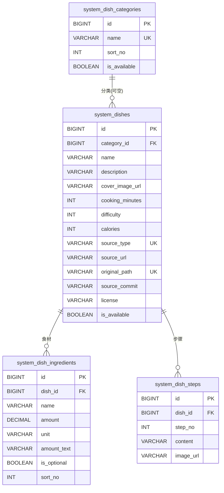

# 系统公共菜谱库（美食广场）数据库设计

> **文档状态**：数据库设计（已完成五项修订，待用户审查确认后进入实施）。
> **设计日期**：2026-11-17。
> **前置调研**：[HOWTOCOOK_DATA_ANALYSIS.md](./HOWTOCOOK_DATA_ANALYSIS.md)。
> **严格限制**：本阶段只做设计，**未修改 Java 源码、未创建/执行任何 SQL、未修改 V1~V11、未导入菜谱、未开发前端、未改动 HowToCook 原始文件**。

---

## 0. 关键事实依据（以实际源码为准）

本节列出的结论均来自对真实源码与迁移脚本的只读检查，是后续设计的前提：

| 事实 | 依据（实际文件） | 对设计的影响 |
|---|---|---|
| Flyway 迁移历史已到 **V11**（非仅 V1） | `src/main/resources/db/migration/` 下存在 `V1~V11` 共 11 个脚本 | 新迁移脚本必须命名为 **V12**，不能使用 V2（`V2__add_shopping_item_purchased.sql` 已存在） |
| 现有 `dish_categories` 有 `family_id NOT NULL` + `uk_dish_categories_family_name UNIQUE(family_id, name)` | `V1__create_homechef_schema.sql` 第 47~60 行 | 家庭分类无法复用为系统分类，**必须新增 `system_dish_categories`** |
| 现有 `dishes` 表 `family_id NOT NULL`、`created_by NOT NULL`（外键指向 `family_members`）、`price NOT NULL` | `V1__create_homechef_schema.sql` 第 62~95 行 | 系统公共菜谱「不属于家庭、无家庭成员创建者、无价格」，**不能写入 `dishes`**，需独立表 |
| 现有 `dish_ingredients.amount DECIMAL(10,2) NOT NULL`、`unit VARCHAR(20) NOT NULL` | `V1__create_homechef_schema.sql` 第 97~111 行 | 无法承载 HowToCook 的「适量/少许/区间/无数字」用量，系统食材表需 `amount/unit` 可空 + `amount_text` 文本 |
| 现有 `dish_steps.content VARCHAR(500)`、`image_url VARCHAR(500)`、`uk_dish_steps_dish_step UNIQUE(dish_id, step_no)` | 同上第 113~125 行 | 系统步骤表对齐该结构 |
| 实体关联使用**普通 `Long` 字段**（非 JPA `@ManyToOne` 对象），由 Flyway DDL 外键/复合外键保护一致性 | `MYSQL_DATABASE_DESIGN.md` 第 4 节；`Dish/DishIngredient/DishStep/DishCategory` 实体 | 新实体遵循同一风格，保持「普通 Long 关联」 |
| 图片上传已实现：`POST /api/upload`（限 jpg/jpeg/png/webp/gif、≤5MB、UUID 文件名，返回 `/uploads/{uuid}.{ext}`）；`WebConfig` 映射 `/uploads/**` 到本地 `uploads/` | `UploadController.java`、`WebConfig.java` | 系统菜谱封面图/步骤图统一走 `imageUrl` URL 字符串，不存文件字节 |
| HowToCook 菜谱 `## 操作` 章节全量 4348 条步骤，单条最长 **198 字符** | 只读扫描 `HowToCook/dishes/**/*.md`（本次修订实测） | `system_dish_steps.content` 保持 `VARCHAR(500)` 不截断，无需 TEXT |

---

## 1. 设计目标

1. 在 MySQL `homechef_platform` 库中新增**独立的系统公共菜谱数据模型**，与现有家庭私有菜品（`dishes`）物理隔离。
2. 系统公共菜谱**不属于任何家庭**，不携带 `family_id`、家庭成员 `created_by`、`price`（价格由家庭在复制时自行定价）。
3. 系统菜谱的**食材、步骤、封面图、分类**独立存储；支持封面图 + 可选步骤图。
4. 记录**原始来源**（`source_type`/`source_url`/`original_path`/`source_commit`/`license`），便于追溯 HowToCook 及后续其它数据源；`source_type + original_path` 组成去重唯一键。
5. 支持分类查询/筛选、菜谱**启用/下架**。
6. **不编造** HowToCook 未提供的难度、卡路里、价格与食材用量——缺失字段一律存 `NULL`，用量以 `amount_text` 保留原始文本。
7. 提供「添加到我家」复制为家庭菜品的事务一致性方案，**不破坏家庭数据隔离、历史订单快照与现有家庭菜品业务**。
8. 普通家庭用户**不能直接修改**系统公共菜谱（系统菜谱的维护权限与家庭菜品完全分离）。

---

## 2. ER 图



> 说明：`system_dishes` → 家庭 `dishes` 之间**不存在数据库外键**。「添加到我家」是业务上的**复制**过程（见第 7 节），复制后生成独立的家庭菜品记录；家庭订单仍只引用 `dishes`，不引用 `system_dishes`。`system_dishes` 的 `source_type` 与 `original_path` **共同组成复合唯一键**（`uk_system_dishes_source`，见第 5 节），并非两个独立唯一键。

---

## 3. 数据表结构

共新增 **4 张表**。命名遵循现有规范（snake_case 复数表名、`fk_/uk_/idx_/chk_` 前缀、`ENGINE=InnoDB`、`utf8mb4`、`utf8mb4_0900_ai_ci`、`DATETIME(6)`、`BOOLEAN + CHECK IN (0,1)`、`DECIMAL` 两位小数）。

### 3.1 `system_dish_categories` — 系统菜谱分类

```sql
CREATE TABLE system_dish_categories (
    id BIGINT NOT NULL AUTO_INCREMENT,
    name VARCHAR(50) NOT NULL,
    sort_no INT NOT NULL DEFAULT 0,
    is_available BOOLEAN NOT NULL DEFAULT TRUE,
    created_at DATETIME(6) NOT NULL DEFAULT CURRENT_TIMESTAMP(6),
    updated_at DATETIME(6) NOT NULL DEFAULT CURRENT_TIMESTAMP(6),
    PRIMARY KEY (id),
    CONSTRAINT uk_system_dish_categories_name UNIQUE (name),
    CONSTRAINT chk_system_dish_categories_sort CHECK (sort_no >= 0),
    CONSTRAINT chk_system_dish_categories_available CHECK (is_available IN (0, 1))
) ENGINE=InnoDB DEFAULT CHARSET=utf8mb4 COLLATE=utf8mb4_0900_ai_ci;
```

### 3.2 `system_dishes` — 系统公共菜谱主表

```sql
CREATE TABLE system_dishes (
    id BIGINT NOT NULL AUTO_INCREMENT,
    category_id BIGINT NULL,
    name VARCHAR(100) NOT NULL,
    description VARCHAR(500) NULL,
    cover_image_url VARCHAR(500) NULL,
    cooking_minutes INT NULL,
    difficulty INT NULL,
    calories INT NULL,
    source_type VARCHAR(30) NOT NULL DEFAULT 'HOWTOCOOK',
    source_url VARCHAR(500) NULL,
    original_path VARCHAR(500) NULL,
    source_commit VARCHAR(64) NULL,
    license VARCHAR(50) NULL,
    is_available BOOLEAN NOT NULL DEFAULT TRUE,
    created_at DATETIME(6) NOT NULL DEFAULT CURRENT_TIMESTAMP(6),
    updated_at DATETIME(6) NOT NULL DEFAULT CURRENT_TIMESTAMP(6),
    PRIMARY KEY (id),
    KEY idx_system_dishes_category (category_id, id),
    KEY idx_system_dishes_available (is_available, id),
    KEY idx_system_dishes_name (name),
    CONSTRAINT uk_system_dishes_source UNIQUE (source_type, original_path),
    CONSTRAINT chk_system_dishes_cooking CHECK (cooking_minutes IS NULL OR cooking_minutes >= 0),
    CONSTRAINT chk_system_dishes_difficulty CHECK (difficulty IS NULL OR difficulty BETWEEN 1 AND 5),
    CONSTRAINT chk_system_dishes_calories CHECK (calories IS NULL OR calories >= 0),
    CONSTRAINT chk_system_dishes_available CHECK (is_available IN (0, 1)),
    CONSTRAINT fk_system_dishes_category
        FOREIGN KEY (category_id) REFERENCES system_dish_categories (id)
        ON DELETE RESTRICT ON UPDATE RESTRICT
) ENGINE=InnoDB DEFAULT CHARSET=utf8mb4 COLLATE=utf8mb4_0900_ai_ci;
```

### 3.3 `system_dish_ingredients` — 系统菜谱食材

```sql
CREATE TABLE system_dish_ingredients (
    id BIGINT NOT NULL AUTO_INCREMENT,
    dish_id BIGINT NOT NULL,
    name VARCHAR(100) NOT NULL,
    amount DECIMAL(10, 2) NULL,
    unit VARCHAR(20) NULL,
    amount_text VARCHAR(100) NULL,
    is_optional BOOLEAN NOT NULL DEFAULT FALSE,
    sort_no INT NOT NULL DEFAULT 0,
    PRIMARY KEY (id),
    CONSTRAINT uk_system_dish_ingredients_dish_sort UNIQUE (dish_id, sort_no),
    CONSTRAINT chk_system_dish_ingredients_amount CHECK (amount IS NULL OR amount >= 0),
    CONSTRAINT chk_system_dish_ingredients_sort CHECK (sort_no >= 0),
    CONSTRAINT chk_system_dish_ingredients_optional CHECK (is_optional IN (0, 1)),
    CONSTRAINT fk_system_dish_ingredients_dish
        FOREIGN KEY (dish_id) REFERENCES system_dishes (id)
        ON DELETE RESTRICT ON UPDATE RESTRICT
) ENGINE=InnoDB DEFAULT CHARSET=utf8mb4 COLLATE=utf8mb4_0900_ai_ci;
```

### 3.4 `system_dish_steps` — 系统菜谱制作步骤

```sql
CREATE TABLE system_dish_steps (
    id BIGINT NOT NULL AUTO_INCREMENT,
    dish_id BIGINT NOT NULL,
    step_no INT NOT NULL,
    content VARCHAR(500) NOT NULL,
    image_url VARCHAR(500) NULL,
    PRIMARY KEY (id),
    CONSTRAINT uk_system_dish_steps_dish_step UNIQUE (dish_id, step_no),
    CONSTRAINT chk_system_dish_steps_step_no CHECK (step_no >= 1),
    CONSTRAINT fk_system_dish_steps_dish
        FOREIGN KEY (dish_id) REFERENCES system_dishes (id)
        ON DELETE RESTRICT ON UPDATE RESTRICT
) ENGINE=InnoDB DEFAULT CHARSET=utf8mb4 COLLATE=utf8mb4_0900_ai_ci;
```

---

## 4. 字段说明

### 4.1 `system_dish_categories`

| 字段 | 类型 | 约束 | 说明 |
|---|---|---|---|
| `id` | `BIGINT` | PK, 自增 | 分类主键 |
| `name` | `VARCHAR(50)` | NOT NULL, UNIQUE | 分类名（素菜/荤菜/水产/早餐/主食/汤与粥/饮料/酱料/甜品/半成品加工） |
| `sort_no` | `INT` | NOT NULL, `>=0` | 展示排序号 |
| `is_available` | `BOOLEAN` | NOT NULL | 分类是否启用 |
| `created_at` / `updated_at` | `DATETIME(6)` | NOT NULL | 审计时间（UTC） |

### 4.2 `system_dishes`

| 字段 | 类型 | 约束 | 说明 | HowToCook 来源 |
|---|---|---|---|---|
| `id` | `BIGINT` | PK, 自增 | 菜谱主键 | — |
| `category_id` | `BIGINT` | NULL, FK | 所属系统分类；可空（未分类） | 目录名映射 |
| `name` | `VARCHAR(100)` | NOT NULL | 菜名 | 标题去「的做法」 |
| `description` | `VARCHAR(500)` | NULL | 简介 | 首段描述文字 |
| `cover_image_url` | `VARCHAR(500)` | NULL | 封面图 URL | 主图 `` |
| `cooking_minutes` | `INT` | NULL, `>=0` | 制作耗时（分钟） | 简介/描述中的时长（如有） |
| `difficulty` | `INT` | NULL, `1~5` | 难度星级 | `预估烹饪难度：★★` |
| `calories` | `INT` | NULL, `>=0` | 卡路里（大卡） | `预估卡路里：XXX 大卡` |
| `source_type` | `VARCHAR(30)` | NOT NULL, 默认 `HOWTOCOOK` | 来源类型（枚举：`HOWTOCOOK`/`XHS`…）；与 `original_path` 组成去重唯一键 | 固定 |
| `source_url` | `VARCHAR(500)` | NULL | 来源仓库根地址（用于人工溯源到仓库，不用于去重） | 仓库 URL |
| `original_path` | `VARCHAR(500)` | NULL | 原始 Markdown 相对路径（定位到具体文件，如 `HowToCook/dishes/vegetable_dish/西红柿炒鸡蛋.md`）；与 `source_type` 组成去重唯一键 | 文件相对路径 |
| `source_commit` | `VARCHAR(64)` | NULL | 导入时来源仓库的 Git commit hash，锁定内容版本（如 `a1b2c3d…`，40 字符） | `git rev-parse HEAD` |
| `license` | `VARCHAR(50)` | NULL | 许可证标识 | `UNLICENSE` |
| `is_available` | `BOOLEAN` | NOT NULL, 默认 TRUE | 启用/下架 | — |
| `created_at` / `updated_at` | `DATETIME(6)` | NOT NULL | 审计时间（UTC） | — |

> **不编造原则**：`cooking_minutes`、`difficulty`、`calories` 均为**可空**，仅在 HowToCook 明确给出时填充；缺失一律 `NULL`，**系统表不设 `price` 字段**。

**来源字段用途区分**：`source_url`（仓库根地址，供人工跳转溯源）与 `original_path`（文件相对路径，定位具体菜谱文件）共同回答「这道菜谱从哪来」；`source_commit`（导入时的 Git commit）回答「这批数据来自哪个内容版本」，用于锁定版本、重跑/比对导入结果。三者分工明确，**去重只依赖 `source_type + original_path`**。

**去重唯一键与 NULL 语义**：`uk_system_dishes_source UNIQUE(source_type, original_path)` 防止重复导入同一来源文件。需注意 MySQL/InnoDB 的 `UNIQUE` 约束**不把 `NULL` 视为重复值**：当 `original_path` 为 `NULL` 时，多条 `(source_type, NULL)` 不会触发冲突，唯一约束仅对 `original_path` 非空的行严格生效。HowToCook 导入场景中每个菜谱必有相对路径（`original_path` 非空），因此唯一约束可正常兜底。**导入程序识别已有记录**不依赖「插入失败」，而是先 `existsBySourceTypeAndOriginalPath(sourceType, originalPath)` 查询，命中则跳过/更新；唯一约束仅作为并发重复导入的最后防线。

### 4.3 `system_dish_ingredients`

| 字段 | 类型 | 约束 | 说明 |
|---|---|---|---|
| `id` | `BIGINT` | PK, 自增 | 主键 |
| `dish_id` | `BIGINT` | NOT NULL, FK | 所属菜谱 |
| `name` | `VARCHAR(100)` | NOT NULL | 食材名 |
| `amount` | `DECIMAL(10,2)` | NULL, `>=0` | 数值用量（仅当可量化时） |
| `unit` | `VARCHAR(20)` | NULL | 单位（g/ml/个/片…） |
| `amount_text` | `VARCHAR(100)` | NULL | 原始用量文本（如「适量」「10～12 只」「小葱挽成结」） |
| `is_optional` | `BOOLEAN` | NOT NULL, 默认 FALSE | 是否可选食材（对应「（可选）」） |
| `sort_no` | `INT` | NOT NULL, `>=0` | 展示排序 |

> 设计要点：`amount`/`unit` 可空，保证「无法量化的用量」不被编造；`amount_text` 完整保留原始文本；`is_optional` 保留「可选」语义。

### 4.4 `system_dish_steps`

| 字段 | 类型 | 约束 | 说明 |
|---|---|---|---|
| `id` | `BIGINT` | PK, 自增 | 主键 |
| `dish_id` | `BIGINT` | NOT NULL, FK | 所属菜谱 |
| `step_no` | `INT` | NOT NULL, `>=1` | 步骤序号（从 1 连续） |
| `content` | `VARCHAR(500)` | NOT NULL | 步骤内容（实测最长 198 字符，500 足够，不截断） |
| `image_url` | `VARCHAR(500)` | NULL | 步骤图 URL（HowToCook 步骤基本无图，多为空） |

> **步骤长度实测结论**：对 `HowToCook/dishes/**/*.md` 全量菜谱的 `## 操作` 章节扫描，共 4348 条步骤行，单条步骤最长 **198 字符**（`meat_dish/商芝肉.md`），远小于 500，故 `content` 保持 `VARCHAR(500)` **无需改为 TEXT**，也不修改现有家庭 `dish_steps` 表。JPA 映射保持普通 `String`（`@Column(nullable = false, length = 500)`），无需 `@Lob` 或 `@Column(columnDefinition = "TEXT")`。

---

## 5. 主外键与索引

| 表 | 主键 | 唯一约束 | 外键 | 普通索引 |
|---|---|---|---|---|
| `system_dish_categories` | `id` | `uk_system_dish_categories_name(name)` | 无 | 无 |
| `system_dishes` | `id` | `uk_system_dishes_source(source_type,original_path)`（允许同名不同做法） | `fk_system_dishes_category(category_id)→system_dish_categories(id)` | `idx_system_dishes_category(category_id,id)`、`idx_system_dishes_available(is_available,id)`、`idx_system_dishes_name(name)` |
| `system_dish_ingredients` | `id` | `uk_system_dish_ingredients_dish_sort(dish_id,sort_no)` | `fk_system_dish_ingredients_dish(dish_id)→system_dishes(id)` | 无 |
| `system_dish_steps` | `id` | `uk_system_dish_steps_dish_step(dish_id,step_no)` | `fk_system_dish_steps_dish(dish_id)→system_dishes(id)` | 无 |

**外键删除策略**：全部 `ON DELETE RESTRICT ON UPDATE RESTRICT`，与现有 `dish_ingredients`/`dish_steps` 保持一致。系统菜谱「下架」用 `is_available=FALSE` 表达，不物理删除；如需物理删除，须先删子表（食材/步骤）再删主表（沿用现有 `deleteDish` 的删除顺序）。

---

## 6. Entity 关系（JPA 设计建议）

新实体遵循现有「普通 `Long` 字段关联」风格（不使用 `@ManyToOne` 对象），由 Flyway DDL 外键保护一致性：

- `SystemDishCategory`（1）—（N）`SystemDish`：`SystemDish.categoryId` 为普通 `Long`。
- `SystemDish`（1）—（N）`SystemDishIngredient`：`SystemDishIngredient.dishId` 为普通 `Long`。
- `SystemDish`（1）—（N）`SystemDishStep`：`SystemDishStep.dishId` 为普通 `Long`。

对应实体类建议（后续实施时创建，本阶段不落地）：

```
com.fooddelivery.entity.SystemDishCategory
com.fooddelivery.entity.SystemDish
com.fooddelivery.entity.SystemDishIngredient
com.fooddelivery.entity.SystemDishStep
```

每个实体含 `@Id @GeneratedValue(strategy = IDENTITY) Long id`；`difficulty`/`calories`/`cookingMinutes` 用 `Integer`（可空）；`amount` 用 `BigDecimal`（可空）；`sourceType` 用 `String`（后续可考虑 `@Enumerated`）；`sourceCommit` 用 `String`（`VARCHAR(64)`）；`isAvailable` 用 `boolean`。时间字段与现有实体一致，统一使用 `LocalDateTime`（UTC）。

---

## 7. 公共菜谱复制为家庭菜品的流程

目标：用户点击「添加到我们的小家」后，后端将 `system_dishes` **复制**为一条独立的家庭 `dishes` 记录（含食材/步骤），家庭订单仍只引用 `dishes`，与系统菜谱彻底解耦。

### 7.1 前置校验

1. 用户已登录，且是目标家庭的**有效成员**（复用 `CurrentUserService.requireMembership(familyId)`，家庭隔离不放松）。
2. `system_dishes` 存在且 `is_available = TRUE`。
3. 用户提交的**家庭售价 `price` 必填**且 `>= 0`（**不允许默认 0**，由用户在复制时定价）。

### 7.2 复制事务（`@Transactional`）

在一个事务内完成，任一环节失败整体回滚：

1. 读取 `system_dishes` + 其 `system_dish_ingredients` + `system_dish_steps` 完整内容。
2. **分类映射**：`system_dishes.category_id` 不能直接写入家庭 `dishes.category_id`（家庭分类有 `family_id` 隔离）。**规则已确认：目标家庭存在同名分类则复用，不存在则自动创建同名家庭分类**（保证菜品有分类归属，不归「未分类」）。并发安全见 7.3。
3. **创建家庭菜品**：写入 `dishes`（`family_id=目标家庭`、`name`、`description`、`image_url=cover_image_url`、`category_id=映射结果`、`cooking_minutes`、`price=用户提供`、`created_by=当前用户`、`is_available=TRUE`）。`difficulty`/`calories` 因家庭 `dishes` 无对应字段，**不复制**（或并入描述，需后续决策）。
4. **复制食材**：`system_dish_ingredients` → `dish_ingredients`，遵循 7.4 的明确规则。
5. **复制步骤**：`system_dish_steps` → `dish_steps`（`step_no`、`content`、`image_url` 直接复制）。
6. 返回新家庭菜品详情。

### 7.3 家庭分类自动创建的并发处理

场景：两个成员同时向同一家庭复制菜谱，都判断「家庭不存在同名分类」并尝试创建，会撞上 `dish_categories` 的 `uk_dish_categories_family_name UNIQUE(family_id, name)`。Service 层按「**先查 → 不存在则插入 → 捕获唯一约束冲突 → 重新查询**」的幂等模式处理：

1. `findByFamilyIdAndName(familyId, name)` 查到 → 直接复用其 `id`。
2. 未查到 → 尝试插入新分类。
3. 插入抛出唯一约束冲突（Spring Data JPA 抛 `DataIntegrityViolationException`，根因 `DuplicateKeyException`/`SQLIntegrityConstraintViolationException`）→ 说明并发下另一事务已先插入，此时**重新 `findByFamilyIdAndName` 读取已提交的那条**并复用其 `id`。
4. 未冲突 → 使用刚插入的 `id`。

**事务边界注意**：唯一约束冲突会使当前事务被标记为回滚（`rollback-only`），直接在同一事务内捕获并继续写 `dishes` 会失败。建议把「获取或创建家庭分类」放到**独立方法 + `@Transactional(propagation = REQUIRES_NEW)`**：该小事务内部捕获冲突后重查，冲突只回滚这个小事务，不污染外层复制事务。数据库唯一约束是并发下的最终安全网；业务层不把「插入失败」当主路径，而是先查、冲突再兜底重查。

### 7.4 食材用量复制规则（已确认）

HowToCook 存在「无法量化」的用量，而家庭 `dish_ingredients.amount/unit` 为 `NOT NULL`。复制规则明确如下（**暂不修改现有家庭 `dish_ingredients` 表**）：

1. `amount` 与 `unit` **均有效**（数值 + 单位齐全）→ **直接复制**到家庭 `dish_ingredients`。
2. **无法量化**（仅有 `amount_text`，如「适量」「少许」「小葱挽成结」）→ 复制前**由用户补齐数值与单位**（前端预览食材列表，用户编辑确认）。
3. **严禁**把「适量」「少许」转换为 `amount = 0`（会编造/弱化用量语义，违背「不编造」原则）。
4. 用户**不补齐**时，**不允许静默丢弃该食材**：后端应明确提示哪些食材缺用量，并**允许用户取消本次添加**（整体不写入，不产生半成品数据）。

### 7.5 一致性与隔离保证

- 复制过程在**单个事务**内完成，食材/步骤/菜品要么全部成功要么全部回滚。
- 复制后家庭菜品与系统菜谱**无任何外键关联**，用户后续修改家庭菜品不影响系统菜谱。
- 家庭订单、购物车、历史订单快照仍只引用 `dishes`，**不引入 `system_dishes` 外键**，不破坏既有隔离与快照设计。

---

## 8. 图片存储方案

- **现状**：图片上传已实现（`POST /api/upload`，UUID 文件名，返回 `/uploads/{uuid}.{ext}`），`imageUrl` 存 URL 字符串；`uploads/` 已加入 `.gitignore`，不入库。
- **系统菜谱封面图**：导入阶段将 HowToCook 本地图片**选择性上传**到本项目 `uploads/`，`cover_image_url` 存 `/uploads/{uuid}.jpg`；`original_path` 记录原始 Markdown 路径、`source_commit` 记录导入时 Git commit、`license` 记 `UNLICENSE`。
- **分档策略**：
  1. 首选：仅导入文字（名称/简介/食材/步骤），`cover_image_url` 置空，规避图片版权与体积问题；
  2. 次选：仅对明确可用的成品图上传；存疑图片不上传，保留文字。
- **步骤图**：HowToCook 步骤基本无图，`system_dish_steps.image_url` 默认空，保留扩展能力。
- **不直接引用** HowToCook 相对路径（`./1.jpeg`）作为运行时 URL，因 HowToCook 文件在 Git 工作区，不属于运行时静态资源。

---

## 9. Flyway V12 迁移方案

- **命名**：`V12__create_system_recipe_schema.sql`（注意：迁移历史已到 V11，**本方案使用 V12，而非 V2**；`V2` 已被 `V2__add_shopping_item_purchased.sql` 占用）。
- **内容**：第 3 节的 4 张 `CREATE TABLE`（含约束/索引）。
- **幂等与安全**：不 `DROP`、不 `ALTER` 任何已有表，仅新增表，不影响 V1~V11 已建立的 schema。
- **分类种子数据**：`system_dish_categories` 的 10 个分类初始数据**建议放入独立的数据初始化流程**（如 `V13__seed_system_dish_categories.sql` 或 `CommandLineRunner` 幂等导入），避免把业务数据混入结构迁移；本阶段仅设计，不执行。
- **执行门槛**：属高风险数据库变更，须经用户明确批准后才能创建并执行；执行前按 `AGENTS.md` 第 7 节备份目标库并验证恢复。

> **本阶段**：仅交付本设计文档，**不创建 `V12` SQL 文件、不执行迁移**。

---

## 10. 后续 API 设计建议（本阶段不实现）

| 接口 | 说明 | 权限 |
|---|---|---|
| `GET /api/system-dishes` | 系统菜谱分页/分类/关键字列表（含封面、难度、耗时） | 登录用户可读（是否匿名可读后续确认） |
| `GET /api/system-dishes/{id}` | 系统菜谱详情（含食材/步骤/来源） | 登录用户可读 |
| `GET /api/system-dish-categories` | 系统分类列表 | 登录用户可读 |
| `POST /api/system-dishes/{id}/copy-to-family` | 复制到目标家庭（`X-Family-Id` + `price`） | 家庭成员 |
| 管理接口（下架/维护） | `PATCH /api/system-dishes/{id}/availability` 等 | 仅系统管理员，普通用户禁止 |

- 浏览/详情接口**不依赖 `X-Family-Id`**；复制接口**必须**校验家庭成员资格。
- 复制接口入参至少包含 `price`（必填、`>=0`、非默认 0）；无法量化的食材由用户在复制前补齐数值/单位，不补齐则明确提示并允许取消本次添加。后端在事务内完成「分类映射（含并发兜底，见 7.3）+ 菜品 + 食材 + 步骤」复制。

---

## 11. 风险与待确认项

1. **Flyway 版本号**：本设计采用 **V12**（非用户任务描述中的「V2」），请确认。
2. **卡路里字段**：`calories` 属健康信息，本设计仅存 HowToCook 明确给出的数值且可空；展示层建议加免责声明，不冒充营养诊断。
3. **`difficulty`/`calories` 是否复制**到家庭菜品：家庭 `dishes` 无对应字段，本设计默认不复制，需确认是否需要扩展家庭表（不推荐，避免破坏现有业务）。
4. **图片导入策略**（第 8 节）：首选仅文字、次选选择性上传，需确认。
5. **`source_commit` 采集**：导入程序需在执行 `git rev-parse HEAD` 后把 commit hash 写入 `source_commit`，该步骤在实施导入脚本时落地（本阶段未执行）。
